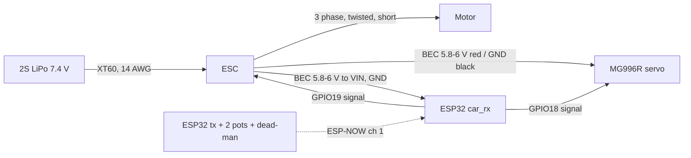

# WK-10: printable 1/10 on-road pan car

A rear-wheel-drive 1/10 on-road car you can print on the Ender 3 V3, built around parts already in the Vision inventory: the Shaluoman foam tires, an MG996R servo, two ESP32 dev boards, 685ZZ bearings from the 68 pc kit, the 3 mm stainless rods, the spring kit, the M3/M4 hardware and the heat-set inserts. The remaining purchases are the motor/ESC, a 2S pack, a charger, a pinion/spur pair and 5 mm rod.

Status 2026-10-10: designed, every part modelled and fit-checked in CAD, firmware compiles. Nothing printed or bought yet.


## Where this came from

The RC car in Vision (`C:\Users\bman0\Code\OpsBrain\data\`, project row 33 "RC-Car") was pipeline test data and never a car. Its brief was "A 40mm cube with a 12mm bore", its research finding was a fixture with placeholder Amazon links, and its BOM pointed at an aluminium "printed chassis plate" with `unobtanium_rating: high`. The registry already flags it as a fixture (`C:\Users\bman0\Code\studio\registry\orchestrator\registry.json`, id `rc-car`). This folder is the real design. Nothing in Vision or the registry was changed.

## Layout and why

| Decision | Choice | Reason |
|---|---|---|
| Class | 1/10 on-road pan car, 257 mm wheelbase, 175 mm track | Owned tires are 1/10 on-road (67 mm, 12 mm hex). 257 mm matches TT-01/TT-02/Sakura D5 and EXPLORER-MK1, so standard 190 mm touring bodies fit. |
| Rear | Pivoting pod, solid 5 mm axle, locked spool | Printed differentials are the most reported failure in printable cars (PLA/PETG diffs soften, seize and click). A pod with a spool has no CV joints, no diff and one axle. A spool pushes slightly in tight corners on foam; acceptable for v1. |
| Front | Sliding-pillar kingpin (3 mm stainless rod, coil spring above the knuckle) | Uses owned rods and springs. Four parts per side, no ball joints in the suspension. Classic 1/12 pan car front end. |
| Motor | Behind the rear axle | Ahead of the axle it collided with the pod pivot. Behind, it puts 58% of the weight on the driven wheels, which matters because launch is traction-limited. |
| Pan | Split at X=86 mm, joined by a splice block that also carries the servo | 240 mm pan does not fit a 220 bed even diagonally. The splice block does two jobs. |
| Control | ESP32 to ESP32 over ESP-NOW, no radio purchase | Two of the four owned dev boards. Failsafe and dead-man are in firmware. |

## Performance (mechcalc `vehicle` engine, deterministic)

Inputs: 1.25 kg, 67 mm tires, 2S 5200, FDR 5.44 (16T/87T 48P), CG 30 mm high, 58% rear.

| Motor | Top speed | 0-30 km/h | Motor heat, continuous | Runtime at continuous current |
|---|---|---|---|---|
| Brushless 3650 ~3250Kv, 45 A ESC (recommended) | 53.5 km/h | 1.33 s | 18 W | 8.9 min (pessimistic: assumes continuous 35 A) |
| Brushed sport 540 + QuicRun 1060 (budget) | 50.8 km/h | 1.35 s | 48 W | 15.6 min |

Both are traction-limited at launch (about 8 N of rear grip against 15 to 18 N of thrust), so 0-30 is the same either way and the firmware ramps throttle at 4 full-scale per second to stop wheelspin. The brushless motor is recommended because it puts 2.6x less heat into a PETG motor plate (PETG softens near 80 C). If you go brushed, check the plate after each run: under 60 C to the touch is fine.

Mass budget (g): printed parts 215, motor 180, ESC 80, battery 256 to 290, servo 55, wheels/hubs/axles 225, ESP32 + wiring 40, body 120, hardware 40. Total about 1245 g. CG X -21 mm, Y -0.8 mm, Z 29 mm. Lateral tip-over at 2.9 g, so it slides long before it rolls.

Gear mesh check: 16T/87T 48P (module 0.529) wants 27.244 mm centres; the model places 27.25 mm (error 0.006 mm). The motor slots give plus or minus 1.5 mm for real mesh setting.

## Bill of materials

### Owned (from the Vision inventory)

| Part | Qty | Used for |
|---|---|---|
| Shaluoman 1/10 on-road foam tires + rims (67 x 26 mm, 12 mm hex) | 4 | Wheels |
| Deegoo MG996R servo | 1 of 4 | Steering |
| ESP32 dev board | 2 of 4 | Car receiver, transmitter |
| 68 pc bearing kit, 685ZZ (5x11x5) | 6 | 2 per knuckle, 1 per pod plate. Count the 685s in the kit; the split is not listed. |
| Lyrlidr 3 mm x 300 mm stainless rod | 1 | Two kingpins at 47 mm |
| Ladinka 304 SS spring kit | 3 | Two kingpin springs (ID 5.5 to 6.5 mm so they pass over the bump-stop sleeve, about 16 mm free length so they preload into the 14 mm gap), one rear pod spring (ID over 3.4 mm, about 20 mm) |
| uxcell M4 shoulder bolt, 5 x 10 mm shoulder | 2 | Pod pivot (the shoulder is the bearing) |
| FFVRVSS heat-set inserts | about 30 M3, 2 M4 | Every printed joint |
| Fgruh M3 kits | about 50 screws + nuts | Button heads under the pan (counterbored), M3x35 for the pod spring |
| WH148 potentiometers, tact switch | 2 + 1 | Transmitter sticks and dead-man |
| RioRand XT60 pigtails, 14 AWG silicone wire, heat shrink | as needed | Battery lead |
| AIO PETG (500 g) | about 90 g | Knuckles, pod, spool, hubs |
| PLA | about 150 g | Pan, front end, braces, trays |
| Hobbypark 12 mm hex hubs | 0 | Not used. They clamp with an M4 locknut, which needs an M4-threaded axle tip that plain 5 mm rod does not have. Printed `hex_hub` replaces them. |

### To buy

Prices are snapshots from the research pass; check before ordering.

| Part | Spec | Price | Source |
|---|---|---|---|
| Brushless combo | 3650 sensorless, about 3250 Kv, 45 A ESC, BEC 5.8 V or 6 V at 3 A, 3.175 mm shaft, M3 at 25 mm (measure) | [price] | [Surpass 3250KV combo](https://www.amazon.com/Surpass-Waterproof-Brushless-Supersonic-Off-Road/dp/B0B5N2YTZS) |
| or brushed budget pair | Tamiya sport-tuned 540 + Hobbywing QuicRun 1060 | $25.60 + $21.99 | [motor](https://store.hobbyetc.com/parts/view/63516), [ESC](https://997rcraceway.com/products/30120201-hobby-wing-1060-brushed-electronic-speed-controller) |
| 2S LiPo hard case | 5000 to 5200 mAh, 138 x 47 x 25 mm max | about $25 | [Zeee 2S 5200](https://www.ypc.co.uk/product/zeee-2s-lipo-battery-5200mah-7-4v-80c-hard-case-rc-battery-with-deans-t-plug-for-1-8-and-1-10-rc-vehicles-car-rc-buggy-truggy-rc-airplane-uav-drone-fpv/) (Deans: swap to an owned XT60 pigtail) |
| Balance charger | HTRC T150 or similar, AC input | $36 to $44 | [HTRC T150](https://china.org.ru/product/60820056961) |
| LiPo charging bag | | [price] | Do not use the salvaged LiPo lot for this car. |
| Pinion | 16T 48P, 1/8 in (3.175 mm) bore | $7.88 | [Hot Racing](https://store.hobbyetc.com/parts/view/63761) |
| Spur | 87T 48P touring spur | $6.49 | [Arrowmax](https://store.hobbyetc.com/parts/view/180878). Drill the centre to 12.2 mm and three M3 holes on a 20 mm circle to bolt it to the printed spool. |
| 5 mm stainless rod | 300 mm, 2 pcs | $4.79 each | [RobotShop](https://www.robotshop.com/products/5mm-x-300mm-stainless-steel-precision-shafting). Rear axle 211 mm, two front stubs 46 mm. Grind a 0.5 mm flat where each set bolt lands (Fanttik rotary tool). |
| 5 mm shaft collars, set screw | 8 | [price] | Wheel retention outboard, axle end float |
| M3 ball links + M3 rod or turnbuckles | 2 tie rods about 46 mm | [price] | Or print two flat links with M3 pivot bolts for v1 |
| 20 mm velcro strap | 1 | [price] | Battery |
| 190 mm 1/10 touring Lexan body | optional | [price] | Posts are 6 mm, at X 144 front and X -115 rear |

## Printed parts

STEP and STL for every part are in `cad/out/` (exported in assembly pose; rotate in the slicer per this table). Regenerate everything and re-run the fit checks with:

```bash
C:/Users/bman0/Code/OpsBrain/.venv/Scripts/python.exe C:/Users/bman0/Code/rc-car/cad/wk10.py
```

| Part | Qty | Material | Orientation and settings |
|---|---|---|---|
| pan_rear, pan_front | 1 each | PLA | Flat, 5 walls, 40% gyroid. Rails up. |
| splice_servo_block | 1 | PLA | Flat, servo posts up |
| front_end | 1 | PETG or PLA | Base down, 6 walls. Checked printable with no support. |
| upper_arm_L, upper_arm_R | 1 each | PLA | Flat |
| knuckle_L, knuckle_R | 1 each | PETG | Axle bore vertical, 100% infill, tree supports from the bed under the steering arm and the web |
| pod_plate_L, pod_plate_R_motor | 1 each | PETG | Flat, 100% infill (the motor plate takes the heat) |
| pod_floor | 1 | PETG | Flat |
| pod_brace | 1 | PLA | Flat |
| spool | 1 | PETG | Flange down, 100% infill |
| hex_hub_x4 | 4 | PETG | Collar down, 100% infill |
| bump_stop_x2 | 2 | PETG | Upright. Sleeve on the kingpin inside the spring, limits bump to 7 mm |
| esp32_tray | 1 | PLA | Flat |

Before printing the bearing parts, print a bore coupon and measure it with the Kynup caliper. Every hole compensation in `wk10.py` (`HOLE_COMP = 0.2`) is an assumed default, not this printer. Change that one knob and re-run.

## Assembly order

1. Heat-set every insert first (Hakko at about 210 C), square to the face.
2. Press 685ZZ bearings into both knuckles and both pod plates. If a seat is loose, a drop of CA; if tight, warm the part.
3. Pan: lay both halves face down, drop the splice block over the joint, eight M3 button heads up from below into its inserts.
4. Front end: four M3 button heads up through the pan. Cut two 47 mm kingpins from the 3 mm rod, deburr, press into the lower arm bosses (drill the boss to 3.0 mm first; it prints about 2.8).
5. Slide each knuckle onto its kingpin, then the bump-stop sleeve and the spring, then bolt the upper arm down so the kingpin passes through its boss. The spring should be preloaded 2 to 3 mm at ride height.
6. Front axles: 46 mm 5 mm rod through the knuckle bearings, collar inboard, hex hub on the flat, wheel, collar outboard.
7. Servo: drop into the splice pocket, M3 into the ear-post inserts. Centre it from the firmware (step 2 of bring-up) before fitting the horn.
8. Tie rods from the horn to the steering-arm posts (M3 ball stud self-taps into the 2.5 mm hole).
9. Pod: plates onto the floor (4 M3), brace between the plates (2 M3 sideways), motor on the right plate through the slots, pinion on the motor shaft.
10. Rear axle: 211 mm rod through both pod bearings and the spool. Bolt the drilled spur to the spool flange, set mesh with a strip of paper between the gears, tighten the motor screws, pinch the spool.
11. Hang the pod on the pan with the two M4 shoulder bolts into the pod's M4 inserts. M3x35 down through the pan's spring arm, spring, into the pod-floor insert. Set it so the pod sits level at ride height.
12. Battery in the left bay with the strap through the slots. ESC and ESP32 tray zip-tied on the right.

## Wiring



- The ESC's BEC powers both the servo and the ESP32. Feed it to the board's VIN/5V pin, which goes through the onboard 3.3 V regulator. Never connect the pack or the BEC to 3V3. Check that your dev board's regulator accepts 6 V (AMS1117 boards do).
- Signal wires: ESP32 3.3 V logic drives standard servo and ESC inputs. GPIO18/19 avoid the strapping pins (0, 2, 5, 12, 15) and the flash pins (6 to 11).
- If the ESC has a separate BEC lead with the servo header, use only one BEC. Two BECs fighting on one rail cooks one of them.
- Main lead 14 AWG, motor leads as short as the pod allows, kept away from the ESP32 antenna.

## Firmware

`firmware/car_rx/car_rx.ino` (car) and `firmware/tx/tx.ino` (transmitter), sharing the packet in `firmware/libraries/WkLink/WkLink.h`. Arduino-ESP32 core 3.x. Both compile:

```bash
C:/Users/bman0/AppData/Local/arduino-cli/arduino-cli.exe compile --fqbn esp32:esp32:esp32 --libraries C:/Users/bman0/Code/rc-car/firmware/libraries C:/Users/bman0/Code/rc-car/firmware/car_rx
```

Safety built in: no valid packet for 250 ms puts the throttle at 1500 us and centres the steering, and pulses keep running so the ESC sees neutral instead of a frozen value. Throttle only moves while the transmitter's dead-man button is held, because a pot knob has no return spring. The transmitter refuses to start unless the throttle knob is centred. The car holds neutral for 3 s at boot so the ESC arms on 1500 us. Packets carry a magic number and checksum, and `TX_MAC` binds the car to one transmitter.

Every tuning value is a named constant at the top of `car_rx.ino`: steering centre/endpoints/expo/reverse, ESC limits, throttle slew, failsafe time.

Alternative control: a PS4/PS5/Switch controller through [Bluepad32](https://github.com/ricardoquesada/bluepad32) on the car's ESP32 (classic ESP32 only, which these are). That removes the second board and gives a sprung trigger. Not built here; say if you own one of those controllers.

## Bring-up (bench, wheels off the ground)

1. Flash `car_rx`, open serial at 115200, note the car MAC. Flash `tx`, note the tx MAC. Paste each into the other sketch (`CAR_MAC`, `TX_MAC`) and reflash both.
2. Servo horn off. Power the car from USB only (no ESC). Confirm `link=1` and the steering pulse follows the steer pot. Fit the horn square at 1500 us.
3. Fit tie rods. Move `STEER_LEFT_US` / `STEER_RIGHT_US` inward until the wheels stop just short of the knuckles' 28 degree lock (the CAD sweep is cleared to 28 degrees with 4.8 mm to spare). Servo buzzing at full lock means the endpoint is too far.
4. Pinion off. Connect the ESC and battery. Run the ESC's own throttle calibration with the TX (neutral, full, reverse per its manual). Check the motor spins the right way; swap two motor wires if not.
5. Failsafe test: throttle up with the wheels off the ground, unplug the TX power bank. The motor must stop within a quarter second. Release the dead-man: the motor must stop. Do not drive until both pass.
6. Pinion on, mesh set, first floor run at low throttle.

## Test plan

| Test | Pass |
|---|---|
| Failsafe (TX off, dead-man released) | Motor stops within 250 ms |
| Range, open lot | Steering responds at the far end of the lot; ESP32 PCB antennas are rated under about 150 m |
| Tracking | Car runs straight 10 m at half throttle after trim |
| Steering | No servo buzz at either lock; no wheel-to-chassis contact at lock with suspension compressed |
| Heat, after a 5 minute run | Motor and motor plate under 60 C, ESC under 70 C |
| Runtime | Note minutes to the ESC's low-voltage cutoff; compare with the 8.9 min prediction |
| Top speed | Compare a timed 20 m pass with the 53 km/h prediction; record both in this table |

## Known gaps

- Fit checks (`checks()` in `wk10.py`, run on every build) cover: no printed part overlaps another, wheel and knuckle sweep to 28 degrees lock (4.8 mm min gap), front travel +7/-5 mm at straight and full lock (1.5 mm), rear pod swing of 4 degrees each way (0.4 mm), spur and motor ground clearance, bed fit and solid validity. They do not cover the real rim hex depth and offset (not in the listing), the tie-rod path, or spring solid height.
- MG996R ear-hole spacing (49.5 mm) and ear height (26.5 mm), the ESC footprint and the motor hole spacing are listing values or 540 standards. Measure the parts you get and change `SERVO_HOLE_SPC`, `SERVO_EAR_Z`, `MOTOR_HOLE_SPC` in `wk10.py`.
- The front has no damping beyond spring friction, and the rear pod has one spring and no damper. Fine on smooth pavement. Grease on the kingpins adds a little damping.
- Locked rear axle: expect push in tight turns. v2 path is a bought steel 1/10 gear diff in the spool's place (EXPLORER-MK1 uses HSP 02024/03015 parts).
- No body designed. Any 190 mm touring Lexan body on the 6 mm posts.

## Reference builds

Researched 2026-10-09:

- [OpenRC F1](https://www.printables.com/model/2714-openrc-f1-car-110-rc-car) (CC BY-SA): print-settings baseline.
- [DKS-Basic 1/10](https://www.printables.com/model/447947-chassis-110-adaptable-dks-basic) (CC BY): solid driven rear axle, brushed 540 + QuicRun 1060. Community mods found 3900 Kv too fast.
- [EXPLORER-MK1](https://www.printables.com/model/691100) (CC BY-NC): 257 mm wheelbase, 1.4 kg, 50 km/h. Closest geometry; source of the steel-diff upgrade path.
- [Tarmo5](https://www.printables.com/model/348623) (CC BY-NC-SA): joint slack and CV wear reports shaped the no-CV, no-diff choice.

Nothing here copies geometry from these; they set the targets and the failure list.
