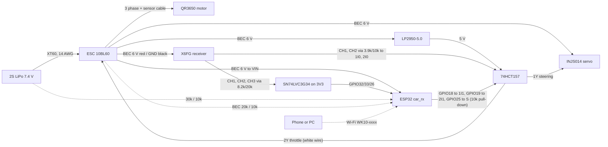

# WK-10: printable 1/10 on-road pan car

A rear-wheel-drive 1/10 on-road pan car you can print on the Ender 3 V3, built around parts I already had (Shaluoman foam tires, ESP32 dev boards, 685ZZ bearings, springs, M3/M4 hardware, heat-set inserts) plus the bought parts that fail when printed. You drive it with a hobby 2.4 GHz pistol radio. An ESP32 behind a hardware mux adds telemetry, phone tuning, and phone or Python driving when the radio's CH3 switch hands it control; it can never stop the radio from taking back over. Purchases total about $470 with tax (itemised below).

Status 2026-10-13: revision F. Designed, every part modelled and fit-checked in CAD (bought parts from their makers' published dimensions), closed-form load checks pass, firmware compiles and its host tests pass. Nothing printed, bought or run yet.

Revision F came out of a hostile review of revision E (three independent reviewers: a comparison with proven 1/10 pan cars and printable RC cars, a mechanical CAD review, and an electronics/firmware review). It found three parts that could not be built or would break on the first run, a failsafe that coasted for about 335 m from top speed, and a Wi-Fi control link that was fine for a demo and wrong for a 52 km/h car. Every finding and its fix is in [Review history](#review-history).


## Layout and why

| Decision | Choice | Reason |
|---|---|---|
| Class | 1/10 on-road pan car, 257 mm wheelbase, 164 mm track, 190 mm over the tires | Owned tires are 1/10 on-road (67 mm, 12 mm hex). 257 mm and 190 mm match the 1/10 GT bodies made for 190 mm pan cars (PROTOform Venturi GT, Bittydesign Ahura and P-GT3R). |
| Control | Hobby radio primary (DumboRC X6 + X6FG gyro receiver); ESP32 behind a 74HCT157 mux for telemetry, tuning and autonomy | Frequency hopping, 10 to 20 ms latency, a sprung trigger and wheel, trims and endpoint adjustment, and a receiver failsafe. The ESP32 select line is pulled down to the radio, so a dead or booting ESP32 cannot hold the car. |
| Front | Sliding pillar on a hardened 3 mm kingpin in a 27.4 mm brass-bushed barrel; kingpin 10.5 mm ahead of the axle | The forward kingpin gives 10.5 mm of mechanical trail (the steering self-centres) and opens the inboard end of the knuckle so both bearings and their spacer go in from one side. Scrub is 21 mm (Rev E: 31.5). Brass on steel cuts the friction that made Rev E's PETG barrel bind. |
| Steering | Injora INJS014 low-profile servo sunk through the pan, Kimbrough 25T servo saver, printed bar with two 5.8 mm ball studs, Hot Racing cups on cut M3 rods, 28 mm knuckle arms straight back | Solved numerically (`steering()` in `wk10.py`, branch-tracked, 3D rod length): 99% Ackermann both ways, 37 degrees of servo for 28 degrees of lock, 66 degree minimum transmission angle, 0.26 degrees of bump steer per 3 mm (1.15 at full travel). The saver protects the servo gears in a crash; the ball cups remove the 3.6 degrees of toe play Rev E's loose printed eyes had. |
| Rear | Pivoting pod on two M4 shoulder bolts, two Injora 53 mm oil coilovers (one each side), locked spool | Damped and symmetric (Rev E had one spring off to one side and no damper). The spur bolts to an aluminium 5 mm flange coupling clamped by two set screws on the axle's flat, instead of a printed D-bore. A spool suits high-grip asphalt and carpet; a diff is the v2 path if hubs or spur suffer. |
| Wheels | Tamiya 53823 aluminium clamping 12 mm hexes on hardened 5 mm shafts | Printed hexes with one set bolt were the weakest drive link in Rev E. |
| Crash structure | Schumacher foam bumper 10 mm ahead of the tire nose on a printed plate; gear cover; battery forward stop | Rev E's tires were the bumper. |
| Body | PROTOform Venturi GT on four 6 mm aluminium standoffs, all on the pan | Polycarbonate at about 90 g. Post tops are computed from the shell (skin + 9 mm). Rev E's rear posts rode the pod and turned the body into a pitch spring. |
| Materials | PETG for every printed part | PLA softens at 55 to 60 C, below a parked car's interior in a Florida summer. |
| Pan | Split at X=86 mm, spliced by a block that also carries the servo, ahead of the joint | 240 mm pan does not fit a 220 bed. The joint stays whole under the block. |

## Performance (mechcalc `vehicle` engine, deterministic)

Inputs: 1.33 kg, 67 mm tires, Hobbywing QR3650 3600 Kv on 2S, 14T/87T 48P (6.21:1), CG 30.2 mm high, 55% rear (every part's mass at its own centroid, `review/data.json`; the Rev F bought chassis parts are estimates until weighed).

| Metric | Value |
|---|---|
| Top speed | 52.6 km/h |
| 0-30 km/h | 1.41 s |
| 0-50 km/h | 3.13 s |
| Peak current | 60 A (pack can source 416 A) |
| Motor heat, continuous | 24.5 W |
| Runtime | 8.9 min at continuous 35 A, so real runs (part throttle) last longer |
| Lateral tip-over | 2.7 g, so it slides long before it rolls |

Launch is traction-limited: about 8 N of rear grip against 25 N of thrust. The radio's throttle curve or the ESC's punch setting is where to tame it.

Gearing with the 13T to 17T pinion set (the motor slot gives 1.0 mm each way, enough for all five):

| Pinion | Ratio | Centre distance | Use |
|---|---|---|---|
| 13T | 6.69 | 26.46 mm | Small lot, more punch |
| 14T | 6.21 | 26.72 mm | Default, about 53 km/h |
| 15T | 5.80 | 26.99 mm | About 56 km/h |
| 17T | 5.12 | 27.52 mm | Long straights; keep the motor under 72 C |

## Bill of materials

### To buy

Prices checked 2026-10-12/13. Brackets mark items whose listing hides the price; fill them in at checkout.

| Part | Pick | Why this one | Price |
|---|---|---|---|
| Motor + ESC | [Hobbywing QuicRun 10BL60 Sensored G2 + QR3650 SD 10.5T G2](https://store.hobbyetc.com/parts/view/181393) | 6 V / 4 A BEC runs the servo, receiver and ESP32. 3600 Kv, 36 x 52.8 mm | $89.99 |
| Radio | [DumboRC X6 + X6FG](https://shop.makerfire.com/products/dumborc-x6-transmitter-x6f-x6fg-receiver) | 6 channels, gyro receiver, 3.3 to 10 V supply. Brake failsafe is not documented by the maker: bench-test it | $43.99 |
| Steering servo | [Injora INJS014](https://www.injora.com/products/14kg-metal-gear-digital-core-servo-for-1-10-rc-car) | Low profile (28.8 mm), 25T, 14 kg-cm, 0.08 s at 6 V. Ear spacing and spline offset not published: measure | $18.99 |
| Servo saver | [Kimbrough KIM114, 25T](https://store.hobbyetc.com/parts/view/5704) | Saves the servo gears in a crash | $5.00 |
| Ball cups | [Hot Racing RCS160C03, 8 with 5.8 mm balls](https://store.hobbyetc.com/parts/view/73558) | Tie rods without slop; rods are cut M3 stainless screws | $6.88 |
| Wheel hexes | [Tamiya 53823 5 mm clamping hex, 4](https://www.adrenalinercracing.com/products/tamiya-5mm-aluminum-clamping-wheel-hex-blue-4) | Clamp the axle, no flat needed | $22.40 |
| Rear shocks | [Injora 4M-24 53 mm threaded oil shocks, 4](https://997rcraceway.com/products/4m-24bs-4-injora-53mm-aluminum-threaded-oil-filled-shocks-for-1-18-trx4m-4m-24) | Two used; 39 to 53 mm, ride height on the threaded collars. Add shock oil you have (or about 300 cSt) | $23.99 |
| Foam bumper | [Schumacher SCHU7790](https://store.hobbyetc.com/parts/view/146324) | Trim to 110 mm wide | $6.80 |
| Kingpin bushes | [K&S 9822 brass tube 4.0 x 3.1, 3 pcs](https://www.ebay.com/p/1500179638) | Cut two 27 mm lengths | $11.77 shipped |
| Kingpins | [QXCIVR hardened 3 x 100 mm rod](https://www.amazon.com/QXCIVR-Chrome-Hardened-Optical-Printer/dp/B0DLM85W63) | HRC 58-62; cut two 60 mm | [price] |
| Axles | [uxcell hardened 5 x 200 mm shaft, 2](https://www.amazon.com/uxcell-Linear-Hardened-Printer-Machine/dp/B0D4VKQ5R3) | Rear axle 172 mm, two front stubs 32 mm | [price] |
| Spool hub | 5 mm bore aluminium rigid flange coupling, 22 mm flange, 4 x M3 on 16 mm | Hub must be 10.5 mm long or less (the CAD checks 10) | [price] |
| Body posts | [Hot Racing 6 x 58 mm M3 standoffs (2), 2 packs](https://store.hobbyetc.com/parts/view/35784) | Cut the rear pair to length | $9.76 |
| Mux + supply | [TI SN74HCT157N](https://www.digikey.com/en/products/detail/texas-instruments/SN74HCT157N/376831), LP2950-5.0, SN74LVC3G34 + SOT-23-8 adapter, 3 mm LED, 12 mm passive piezo | Wiring and pin table below | $0.96 + [price] |
| 2S LiPo | [Zeee 5200 mAh 80C XT60, 2-pack](https://www.amazon.com/dp/B08DCYVHSF) | 138 x 47 x 25 mm fits the 47.5 mm bay | $35.99 |
| Charger | [SkyRC B6AC Neo](https://www.amazon.com/s?k=SkyRC+e450+charger) (ASIN B0CV64ZB2L) | AC built in | $53.00 |
| LiPo bag | [Zeee bag 28 x 22 cm](https://www.amazon.com/dp/B0FWBMK87X) | Charge and store in it | $6.29 |
| Pinions | [ShareGoo 48P 13T to 17T](https://www.amazon.com/s?k=48P+pinion+set+13T+17T) (ASIN B09FGC6JV4) | Gearing range | $11.49 |
| Spur | [Kimbrough #148 87T 48P](https://www.amazon.com/dp/B0006O1QW6) | Drilled on the carrier's spigot | $9.13 |
| Shaft collars | [5 mm bore, 10 mm OD, 12 pcs](https://www.amazon.com/s?k=5mm+bore+shaft+collar+set+screw+10+pcs) (ASIN B0F9P5CNSL) | Front stub inboard retention, rear left | $5.99 |
| Battery strap | [Hobbypark 20 x 200 mm](https://www.amazon.com/s?k=20mm+hook+and+loop+battery+strap+rc+lipo) (ASIN B08HHHFMCJ) | | $6.97 |
| Body | [PROTOform Venturi GT](https://www.amazon.com/dp/B0CDZ1FSXN) | 190 mm class, 430 long, 258 WB, wing included | $29.99 |
| Body clips | [Traxxas 1834 (12)](https://www.walmart.com/ip/37293444) | R-clips for the four posts | $6.95 |
| **Total** | | | **$406.33 + bracketed items (about $30 at typical prices), about $470 with 7.5% Duval tax** |

That is over the $375 approved for Rev F. The ways back under it, in order of what they cost the car: skip the charger if one is on hand ($53); print a friction damper for the pod instead of the shocks ($24, loses oil damping); use one battery instead of the 2-pack (about $15). Dropped from Rev E: the MG996R (too tall: its horn put the tie rods 24 mm above the knuckle arm), the stainless rod (hardened shaft replaces it), printed tie rods, printed hex hubs, the printed spool.

### Already owned

| Part | Qty | Used for |
|---|---|---|
| Shaluoman 1/10 on-road foam tires + rims (67 x 26 mm, 12 mm hex, 3 mm offset) | 4 | Wheels |
| ESP32 dev board (DevKitC V4) | 1 (+1 for the legacy transmitter) | Telemetry, tuning, autonomy |
| 685ZZ bearings (5 x 11 x 5) | 6 | 2 per knuckle, 1 per pod plate |
| Ladinka 304 SS spring kit | 2 | Kingpin springs: ID 5.5 to 6.5 mm (over the bump-stop sleeve), about 18 mm free (16 mm gap) |
| uxcell M4 shoulder bolt, 5 x 10 mm shoulder | 2 | Pod pivot |
| FFVRVSS heat-set inserts | about 50 M3, 2 M4 | Every printed joint |
| Fgruh M3 kits | about 70 screws + nuts | Structure, ball studs into inserts, two M3 x 35 cut for the tie rods |
| MOGAOPL resistor kit | see Wiring | Dividers, pull-down, LED and piezo |
| RioRand XT60 pigtails, 14 AWG silicone wire, heat shrink | as needed | Battery lead |
| AIO PETG (500 g) | about 330 g | Every printed part |

## Printed parts

`cad/out/print/` holds a print-ready STL and STEP for every part in its slicer orientation, plus `calibration_coupon.stl`. `cad/out/` holds the parts in assembly pose and `wk10_assembly.step` is the whole car with the bought parts. Regenerate everything and re-run the fit, kinematic and load checks with:

```bash
python cad/wk10.py
```

Print the calibration coupon first (PETG, same settings as the bearing parts) and measure every hole. `HOLE_COMP = 0.2` is an assumed default. Change it until a 685ZZ drops into the 11.2 mm hole with a light press and the brass tube presses into the 4.2 mm hole, then re-run. Layer height 0.2 mm.

| Part | Qty | Settings |
|---|---|---|
| calibration_coupon | 1 | 100% |
| pan_rear, pan_front | 1 each | 5 walls, 40% gyroid; pan_rear supports under the shock-tower arms |
| splice_servo_block | 1 | 5 walls |
| front_end | 1 | 6 walls, 60%; base down |
| upper_arm_L, upper_arm_R | 1 each | 100% |
| knuckle_L, knuckle_R | 1 each | 100%, barrel upright, tree supports under the arm's high run and the housing |
| steer_bar | 1 | 100% |
| pod_plate_L, pod_plate_R_motor | 1 each | 100% |
| pod_floor, pod_brace | 1 each | 5 walls, 40% |
| spur_carrier | 1 | 100%, nut pockets up |
| gear_cover | 1 | outer face down |
| battery_stop, esp32_cradle, esp32_lid | 1 each | 3 walls |
| bump_stops | 2 | 100% |
| race_shims_x3, lip_shims_x2, race_spacers_x2 | as named | 100% |

## Assembly order

1. Heat-set every insert first (about 210 C), square to the face.
2. Knuckles: press the brass tube into each barrel and ream it to 3.05 mm. Press the inner 685ZZ from the inboard end against the 1 mm lip, then the 3 mm race spacer, then the outer 685ZZ from the outboard end. Pod plates: press each 685ZZ from the outboard face against its inboard lip.
3. Pan: both halves face down, splice block over the joint, seven M3 button heads up from below.
4. Front end: four M3 up through the pan. Cut two 60 mm kingpins from the hardened rod, deburr, press into the lower-arm bosses (drill to 2.9 mm first).
5. Slide each knuckle onto its kingpin, then the bump-stop sleeve and spring, then bolt the upper arm down over the kingpin.
6. Front stubs (32 mm hardened): collar, lip shim (1.3 mm), through both bearings, race shim (1 mm), clamping hex, wheel. Tighten the collar against the lip shim so the stub has no end float.
7. Servo into the splice pocket (it drops through the pan to a 1 mm skin), M3 into the ear-post inserts; lead out through the tunnel under the -Y ear. Centre it from the radio, fit the servo saver pointing forward, then bolt the steer bar to the saver's arm (its channel stops it turning). Ball studs into the bar's underside and the knuckle arm tips.
8. Tie rods: two cut M3 rods with a cup each end, 54.5 mm ball to ball to start; half a turn of one cup moves toe by about 0.3 degrees.
9. Pod: plates against the floor rails, side bolts into the rail inserts, brace between them. Motor on the right plate. Pinion on the shaft with its hub inboard.
10. Spur: drill the centre to 10.2 mm, sit it on the carrier's spigot, drill the four holes at 3.2 mm through the carrier. Grind a 0.5 mm flat on the axle where the coupling sits. Coupling, spur, carrier with four M3 x 16 and nuts.
11. Rear axle (172 mm hardened) through the left bearing, the right bearing, the carrier and the coupling; set screws on the flat. Left collar with a race shim against the left bearing. Set mesh with paper, tighten the motor. Gear cover on with two M3.
12. Hang the pod on the two M4 shoulder bolts. Shocks between the pod-floor ears and the pan's shock towers (M3 through each eye into the side inserts). Set ride height on the threaded collars until the pan's rear edge sits 5 mm off a flat table with the battery in.
13. Battery in the left bay against the forward stop, strap through the slots. ESC fan-up on servo tape on the right. ESP32 board on the cradle ledges, USB to the rear, leads soldered, lid on.
14. Body: offer the painted shell up with the wheels straight. Cut each standoff so it stands 9 mm above the skin, drill the R-clip hole 4 mm above the skin.

## Wiring



- Set the 10BL60's BEC to 6 V, not 7.4 V, until the servo's label confirms it takes 7.4 V.
- The BEC powers the receiver, the servo, the ESP32 (VIN/5V pin, through the onboard 3.3 V regulator) and the LP2950-5.0 that feeds the 74HCT157. Never connect the pack or the BEC to 3V3. Check your dev board's regulator accepts 6 V (AMS1117 boards do).
- USB and BEC together: check whether your board has a diode between the 5V pin and USB VBUS. Without one, plugging USB in with the BEC powered back-feeds 6 V into the computer. Until checked, unplug the ESC lead before plugging USB in.
- The 74HCT157 picks the receiver (S low) or the ESP32 (S high) for both the servo and ESC signals. S has a 10k pull-down, so a dead or booting ESP32 leaves the radio in control. Receiver CH1/CH2 reach the mux through a 3.9k/10k divider each. Pin-by-pin wiring and the pin table are in `firmware/CHANGES-revF.md`.
- Receiver CH1/CH2/CH3 also reach GPIO32/33/26 on a separate branch through an 8.2k/20k divider and an SN74LVC3G34 buffer on 3V3, so any receiver signal level from 3.3 to 7.4 V is safe for the ESP32.
- The X6FG's steering gyro acts on CH1 only while the receiver drives the servo. Under ESP32 control the mux bypasses it. Start with gyro gain low.
- Battery divider (required): pack + to 30k to GPIO34 to 10k to GND, 100 nF from GPIO34 to GND. 8.4 V reads 2.1 V at the pin. It draws 0.2 mA, so unplug the pack after a run. BEC monitor: BEC + to 20k to GPIO35 to 10k to GND, 100 nF. Calibrate both against a multimeter in Tuning (`vbatRatio`, `becRatio`: new = old x meter / reported).
- Status LED on GPIO23 (330R), passive piezo on GPIO22 (100R).
- Outputs avoid the strapping pins (0, 2, 5, 12, 15) and the flash pins (6 to 11); receiver inputs avoid GPIO36/39 (spurious interrupts while the ADC and Wi-Fi run).
- Main lead 14 AWG, motor leads as short as the pod allows, kept away from the ESP32 antenna.

## Firmware

Arduino-ESP32 core 3.x:

- `firmware/car_rx/car_rx.ino` runs on the car: receiver capture, mux select, battery and BEC monitoring, the phone page (WebSocket, port 81), UDP driving (port 4210) and OTA.
- `firmware/libraries/WkLink/WkLink.h` holds the control decision `wk_control_step()`, the ESC brake/reverse tracker, the tuning record, input validation and the self-test.
- `firmware/tx/tx.ino` is the optional legacy ESP-NOW transmitter.
- `firmware/CHANGES-revF.md` has the pin table, mux pinout, failsafe table and the review this firmware answered.

Both sketches compile (car 80% of flash, transmitter 68%). The car needs the WebSockets library by Markus Sattler, pinned:

```bash
arduino-cli lib install WebSockets@2.7.2
```

```bash
arduino-cli compile --fqbn esp32:esp32:esp32 --libraries firmware/libraries firmware/car_rx
```

The same `wk_selftest()` the car runs at boot also runs on the PC, followed by simulated-clock scenarios that drive `wk_control_step()` with jittered steps, real receiver frame timing and a lagging mux: receiver failsafe and CH3 off force manual, a stale ESP32 command brakes then hands back, the brake never lands when the ESC could take it as reverse, low battery releases and alarms, a single bad ADC sample does not, BEC over-voltage blocks engaging, and stray receiver interrupts cannot invent a pulse. It passes, and 25 deliberately broken copies of the header each fail it. Build it with zig's bundled C++ compiler (`pip install ziglang`):

```bash
python -m ziglang c++ -std=c++17 -Wall -Wextra -I firmware/libraries/WkLink firmware/test/host_selftest.cpp -o build/selftest.exe
```

### Ways to drive

1. **Radio (primary).** Transmitter on first, then the car. With CH3 on manual the receiver drives the servo and ESC through the mux; the ESP32 only watches.
2. **Phone.** Set `AP_PASS` in `car_rx.ino` (8+ characters; the access point stays off while it reads `CHANGE-ME`). Join Wi-Fi `WK10-xxxx`, open `http://192.168.4.1`, flip CH3 to autonomy. The ESP32 takes over after 500 ms with every check passing (two chirps, LED solid). Touch the pad and slide up for throttle, sideways to steer; hold the BRAKE / REVERSE bar to brake (hold it again after a stop to reverse). Lifting every finger is neutral. The page shows why the ESP32 is not driving when it is not.
3. **Python.** Close the phone page (one client at a time), flip CH3 to autonomy, then `python tools/drive.py figure8` drives a 16 second figure-eight at quarter stick (times `maxThrottle`). Write your own `program(t) -> (steer, throttle)` and pass it to `run()`, which arms the car, waits for the mux, streams UDP frames at 50 Hz, aborts if the radio takes control back or the car goes quiet, and stops the car however the script ends. Frame format: `"<token> <seq> <steer -1000..1000> <throttle -1000..1000> <deadman 0|1>"` to UDP 4210. `GET /state` returns pulses, mux state, receiver channels, pack and BEC volts and link stats.
4. **Legacy transmitter (optional).** The second ESP32 with two pots over ESP-NOW, only while CH3 is on autonomy. Not part of bring-up.

### Tuning without reflashing

The phone page's Tuning section edits every setting and saves it to flash: steering centre/endpoints/reverse/expo, dual rate and throttle-scaled steering limit, ESC neutral/forward/reverse limits, throttle slew, `maxThrottle`, failsafe time, failsafe brake strength and time (3 s max; a brake too light to clear the ESC's neutral band is rejected), ESC running mode (`escMode`: 0 Fwd/Rev/Brake, 1 Fwd/Brake, 2 Fwd/Rev), and the two divider calibrations. It accepts changes only after the ESC has seen neutral for 3 s with no dead-man held; otherwise it answers 409. Every value is range-checked (`wk_cfg_valid`). `escNeutral` is limited to 1470..1530 us; set it to the radio's throttle neutral (read `rx` on the status line). Saving drops the mux to the radio for the flash write. OTA uses `AP_PASS` and also drops the mux.

### Safety

- The radio always wins. The mux passes the receiver unless GPIO25 is high, and GPIO25 has a 10k pull-down, so a dead, resetting or booting ESP32 cannot hold the car.
- The ESP32 raises the mux only when CH3 reads 1800 to 2200 us on two pulses in a row, CH1 and CH2 pulses are under 100 ms old, its control loop is on time, its command source is fresh and armed with throttle at zero, the pack rested at 3.7 V/cell or more, the BEC reads 6.5 V or less, and all of that has held for 500 ms.
- It drops the mux in the same 10 ms step if the receiver stops, the pack sags under 3.3 V/cell for 2 s (latched until power-cycle, with the buzzer), five battery or BEC readings in a row are bad, the loop runs late, or OTA or a settings save starts. CH3 to manual hands back at the next gap between pulses, within 50 ms.
- If only the ESP32's command source fails (phone Wi-Fi drop, script killed), it brakes at 35% of the reverse span for 3 s, then hands back to the radio, but only when the ESC would really brake. If the ESC could take below neutral as reverse it sends neutral and hands back at once. Rev E coasted about 335 m from top speed here.
- Set the receiver failsafe to CH3 manual and CH2 light brake, never "hold". A hold-only receiver hides transmitter loss from the ESP32.
- A control task that stops for 300 ms trips the task watchdog; its interrupt drives the mux select low before the chip resets.
- `maxThrottle` caps ESP32 forward power and starts at 0.5. Reverse is capped at half. Steering is limited above 30% throttle.
- `wk_selftest()` runs at every boot against the config in use. A failure keeps the mux on the radio and fast-blinks the LED.
- The Wi-Fi is WPA2 with your password. Anyone with it can drive the car while CH3 is on autonomy, so do not reuse a real password.

### Bring-up (bench, wheels off the ground)

1. Set `AP_PASS`, install the WebSockets library, flash `car_rx` over USB with the ESC lead unplugged, open serial at 115200. It must print `selftest: pass`. With nothing else connected it shows `mux=0`.
2. Radio: bind the X6FG, put CH3 on a 2-position switch, set the failsafe (CH3 manual, CH2 light brake), confirm CH3's autonomy position reads 1800 to 2200 us in `/state`. Switch the transmitter off with the receiver powered and confirm the ESC brakes: the maker does not document the X6FG's failsafe.
3. Measure the receiver's signal level and fit the dividers to match before connecting it to the ESP32.
4. Saver arm off. Wire everything as above, ESC connected, pinion off. Transmitter on, then the pack. With CH3 on manual, set steering subtrim so the saver goes on pointing straight forward, fit the steer bar and tie rods, then set the radio's endpoints until the inner wheel stops just short of 28 degrees. Calibrate the ESC throttle range from the radio and read its running mode and neutral range.
5. Read `rx` on the phone's status line at centre and both locks and enter them as `steerCenter`, `steerLeft`, `steerRight`; trigger neutral as `escNeutral`; set `escMode`. Correct `vbatRatio` and `becRatio` against a meter. Save.
6. Flip CH3 to autonomy with the phone page open: two chirps, LED solid, `mux` true. The servo follows the phone with no jump at the handover. Scope mux 1Y and 2Y while flipping CH3 both ways.
7. Failsafe, wheels in the air, forward at low throttle from the phone: (a) CH3 to manual, (b) transmitter off, (c) phone Wi-Fi off, (d) Ctrl+C `drive.py`, (e) pull the ESP32's BEC lead. (a), (b), (e) hand the car to the radio within 0.1 s. (c) and (d) brake for 3 s, then hand back. Repeat (c) after brake, release, reverse: no brake, immediate hand-back, wheels never spin backwards. Do not drive until all pass.
8. Pinion on, mesh set, first floor run on the radio, then a phone run with `maxThrottle` at 0.3.

## Test plan

| Test | Pass | Result |
|---|---|---|
| CAD checks | `python cad/wk10.py` prints `checks ok` | pass, 2026-10-13 |
| Host self-test | `host selftest: pass`, 25/25 mutants caught | pass, 2026-10-13 |
| drive.py against a fake car | `test_drive: pass` | pass, 2026-10-13 |
| Calibration coupon | 685ZZ light press in 11.2 mm hole, brass tube press in 4.2 mm hole | [ ] |
| Bought-part dimensions | Every VERIFY value in `cad/bought.py` measured and re-run | [ ] |
| Boot self-test | `selftest: pass` on serial | [ ] |
| Failsafe (CH3 flip, TX off, phone Wi-Fi off, script killed, ESP32 unplugged; after reverse) | Radio has the car within 0.1 s for CH3/TX/ESP32; 3 s brake then hand-back for phone/script; never a reverse pulse after reverse | [ ] |
| Handover pulses | Scope on mux 1Y and 2Y while flipping CH3 both ways: no cut or merged pulse | [ ] |
| Battery gates | Bench supply on the pack tap: no engage under 7.4 V rested; release and alarm after 2 s under 6.6 V | [ ] |
| Kingpins | Knuckle slides full travel under its own spring with no bind, lock to lock | [ ] |
| Rear ride height | Pan rear edge 5 mm off the table, car on its wheels with battery | [ ] |
| Steering | No servo buzz at either lock; no contact at lock with suspension compressed; toe change under 0.5 degrees over full bump | [ ] |
| Tracking | Straight 10 m at half throttle after trim | [ ] |
| Crash | 10 km/h into a foam-padded wall, 5 times: saver slips, no printed part cracks | [ ] |
| Heat, after a 5 minute run | Motor and motor plate under 60 C, ESC under 70 C | [ ] |
| Runtime | Minutes to the ESC cutoff; prediction 8.9 min at full load | [ ] |
| Top speed | Timed 20 m pass; prediction 52.6 km/h on 14T | [ ] |

## Known gaps

- Fit checks (`checks()` in `wk10.py`, run on every build) cover: no part overlaps any other in the assembled pose, printed and bought (only the meshing gear teeth and the ball joints may touch); both knuckle bearings and their spacer can be pressed in from the outboard end against a lip; the front wheel stack-up lands on track / 2; the wheel and knuckle sweep to 28 degrees of lock clear the chassis, body and bumper (2.0 mm); front travel +7/-5 at straight and full lock (0.6 mm); the bought tie rods at both locks clear everything, with the servo saver turned (1.8 mm); the pod's 4 degree swing (1.1 mm) and the shock length inside 39 to 53 mm at both stops; the pinion's face sits across the spur and the shaft reaches it; and the closed-form load cases (kingpin kerb load 216 N, steering arm SF 1.8 at servo stall, spur drive SF 15, pod lug web SF 10.0 at 10 g).
- Not covered: the dimensions the makers do not publish (servo ears and spline offset, saver arm and height, clamping-hex thickness, coupling hub length, shock body and eyes, rim hex depth, foam size, the body's hood and deck heights). Each is one parameter in `cad/bought.py`; measure on arrival and re-run. Also not covered: the tie rods during bump, lead routing, fatigue, impact above about 15 km/h, and print-layer strength beyond the in-plane allowables.
- The firmware has not run on hardware. The host tests prove the control decision on a simulated clock, not the wiring, the receiver capture or the radio. The receiver-failsafe and CH3 checks are software on a live ESP32; a hardware CH3 gate on the mux select is the upgrade path. A receiver whose failsafe can only hold hides transmitter loss from the ESP32.
- Locked rear axle: expect push in tight turns. v2 path is a bought 1/10 pan-car diff.

## Review history

Rev E to Rev F, 2026-10-13. Three independent read-only reviews; every P0 fixed, every P1 fixed or listed under Known gaps.

| Severity | Finding (Rev E) | Rev F |
|---|---|---|
| P0 | Knuckle's inner bearing could not be installed: the kingpin barrel blocked the inboard end | Kingpin moved 10.5 mm ahead of the axle; both bearings and a spacer press in from outboard against a 1 mm lip; the CAD checks the insertion path |
| P0 | Pod plate lugs necked to 1.2 mm around the shoulder-bolt boss | Full-height lug web on the pod floor; 10 g rear load case SF 10.0 |
| P0 | Pinion overlapped the spur by 1 mm of face | Pinion face and shaft reach checked across the full motor slot |
| P0 | Failsafe released the throttle and coasted about 335 m from top speed | Hobby radio with receiver failsafe primary; ESP32 brakes, then hands back |
| P1 | Wi-Fi HTTP control at 20 Hz with no hardware override | 74HCT157 mux, radio by default, select pulled down |
| P1 | MG996R horn put the tie rods 24 mm above the knuckle arm; no servo saver; printed tie-rod eyes gave 3.6 degrees of toe play | Low-profile servo sunk through the pan, Kimbrough saver, Hot Racing ball cups, steering re-solved (99% Ackermann) |
| P1 | PETG barrel on a stainless kingpin: friction and wear | Hardened 3 mm pin in a brass tube |
| P1 | Zero trail, 31.5 mm scrub | 10.5 mm trail, 21 mm scrub |
| P1 | Printed hex hubs and D-bore spool | Tamiya clamping hexes; aluminium flange coupling on a flat; spur torque SF 15 |
| P1 | One undamped spring off to one side of the pod | Two oil coilovers, symmetric |
| P1 | No bumper, no gear cover, battery could slide forward | Foam bumper 10 mm ahead of the tires, gear cover, battery stop |
| P1 | Rear body posts on the pod | All four posts on the pan, heights computed from the shell |
| P1 | PLA parts would soften in a hot car | PETG everywhere |
| P2 | No load cases | `load_cases()` runs with every build |

## Reference builds

Researched 2026-10-09 and 2026-10-13:

- Commercial 1/10 pan cars (Associated RC10R5.1, CRC Gen-X 10, Xray X10, Tamiya F104): pod damping and side springs, 4 mm or hardened kingpins, foam bumpers, ball diffs; the targets for Rev F.
- [OpenRC F1](https://www.printables.com/model/2714-openrc-f1-car-110-rc-car) (CC BY-SA): print settings; builders move the front suspension to nylon because it takes the hits.
- [Tarmo5](https://www.printables.com/model/348623) (CC BY-NC-SA): the "reinforce frequently breaking parts" history is the failure list.
- [EXPLORER-MK1](https://www.printables.com/model/691100) (CC BY-NC): 257 mm wheelbase, 1.4 kg, 50 km/h.
- [Club Race Hero printed pan cars](https://www.liverc.com/news/new-club-race-hero-3d-printed-pan-cars/): print the chassis, buy the pod plates, front suspension, damper and bumper.

Nothing here copies geometry from these; they set the targets and the failure list.

## License

MIT, see [LICENSE](LICENSE). Bought parts are named for reference only; their designs belong to their makers.
