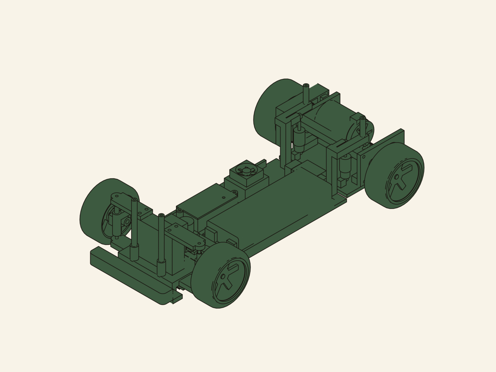
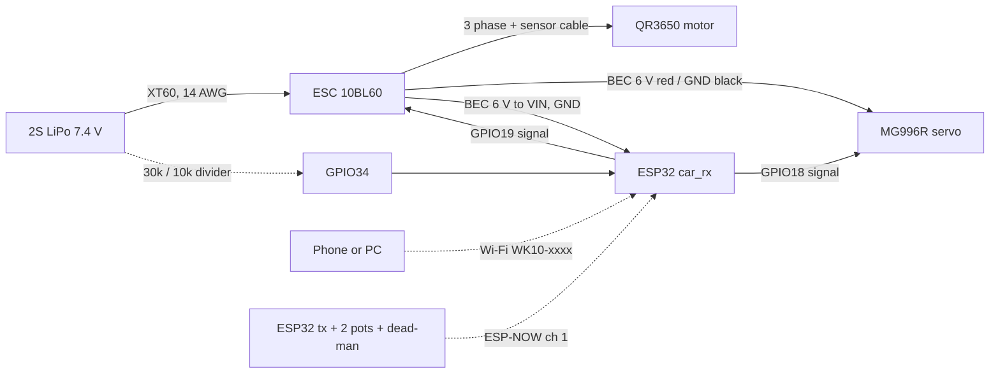

# WK-10: printable 1/10 on-road pan car

A rear-wheel-drive 1/10 on-road car you can print on the Ender 3 V3, built around parts already in the Vision inventory: the Shaluoman foam tires, an MG996R servo, two ESP32 dev boards, 685ZZ bearings from the 68 pc kit, the 3 mm stainless rods, the spring kit, the M3/M4 hardware and the heat-set inserts. You drive it from a phone, from Python, or from a second ESP32 used as a handheld transmitter. Purchases total about $277 with tax (itemised below).

Status 2026-10-12: designed, every part modelled and fit-checked in CAD, firmware compiles. Nothing printed or bought yet.



## Where this came from

The RC car in Vision (`C:\Users\bman0\Code\OpsBrain\data\`, project row 33 "RC-Car") was pipeline test data and never a car. Its brief was "A 40mm cube with a 12mm bore", its research finding was a fixture with placeholder Amazon links, and its BOM pointed at an aluminium "printed chassis plate" with `unobtanium_rating: high`. The registry already flags it as a fixture (`C:\Users\bman0\Code\studio\registry\orchestrator\registry.json`, id `rc-car`). This folder is the real design. Nothing in Vision or the registry was changed.

## Layout and why

| Decision | Choice | Reason |
|---|---|---|
| Class | 1/10 on-road pan car, 257 mm wheelbase, 175 mm track | Owned tires are 1/10 on-road (67 mm, 12 mm hex). 257 mm matches TT-01/TT-02/Sakura D5 and EXPLORER-MK1, so standard 190 mm touring bodies fit. |
| Rear | Pivoting pod, solid 5 mm axle, locked spool | Printed differentials are the most reported failure in printable cars (PLA/PETG diffs soften, seize and click). A pod with a spool has no CV joints, no diff and one axle. A spool pushes slightly in tight corners on foam; acceptable for v1. |
| Front | Sliding-pillar kingpin (3 mm stainless rod, coil spring above the knuckle) | Uses owned rods and springs. Classic 1/12 pan car front end. |
| Steering | Servo horn pointing rearward, both tie rods on one bolt, knuckle arms straight back | Solved numerically (`steering()` in `wk10.py`): 88% Ackermann, 36.8 degrees of servo for 28 degrees of lock, 0.32 degrees of bump steer per 3 mm. The obvious layout (arms angled at the rear axle) gave over 200% Ackermann with a central servo. |
| Tie rods | Printed, two halves joined by a cut M3 stud in heat-set inserts | Replaces ball links and turnbuckles (saves $15). Loose 3.6 mm eyes on M3 bolts tolerate the tilt from 7 mm of bump over a 68 mm rod. Half a turn of the knuckle half is 0.25 mm of toe. |
| Motor | Behind the rear axle | Ahead of the axle it collided with the pod pivot. Behind, it puts 58% of the weight on the driven wheels, which matters because launch is traction-limited. |
| Pan | Split at X=86 mm, joined by a splice block that also carries the servo | 240 mm pan does not fit a 220 bed even diagonally. |
| Control | Car ESP32 is its own Wi-Fi access point (phone joystick, tuning page, HTTP API) plus ESP-NOW for a second ESP32 transmitter | No radio purchase. Every source goes through one failsafe. |

## Performance (mechcalc `vehicle` engine, deterministic)

Inputs: 1.24 kg, 67 mm tires, Hobbywing QR3650 3600 Kv on 2S, 14T/87T 48P (6.21:1), CG 30 mm high, 58% rear.

| Metric | Value |
|---|---|
| Top speed | 52.6 km/h |
| 0-30 km/h | 1.33 s |
| 0-50 km/h | 2.93 s |
| Peak current | 60 A (pack can source 416 A) |
| Motor heat, continuous | 18 W |
| Runtime | 8.9 min at continuous 35 A, so real runs (part throttle) last longer |
| Lateral tip-over | 2.9 g, so it slides long before it rolls |

Launch is traction-limited: about 8 N of rear grip against 25 N of thrust. The firmware ramps throttle at 4 full-scale per second, and `maxThrottle` starts at 0.5 until you raise it from the phone.

Gearing with the 13T to 17T pinion set (all fit the motor slots, which give 1.5 mm each way):

| Pinion | Ratio | Centre distance | Use |
|---|---|---|---|
| 13T | 6.69 | 26.45 mm | Small lot, more punch |
| 14T | 6.21 | 26.72 mm | Default, about 53 km/h |
| 15T | 5.80 | 26.98 mm | About 56 km/h |
| 17T | 5.12 | 27.51 mm | Long straights; watch motor temperature |

Mass budget (g): printed parts 215, motor 180, ESC 80, battery 250, servo 55, wheels/hubs/axles 225, ESP32 + wiring 40, body 120, hardware 40. Total about 1240 g. CG X -21 mm, Y -0.8 mm, Z 29 mm.

## Bill of materials

### To buy (checked 2026-10-12, Amazon delivering to 32246 unless noted)

| Part | Pick | Why this one | Price |
|---|---|---|---|
| Motor + ESC | [Hobbywing QuicRun 10BL60 SD G2 + QR3650 SD 10.5T G2](https://store.hobbyetc.com/parts/view/181393) | Only combo whose BEC is confirmed: 6 V at 4 A runs the MG996R and the ESP32. 3600 Kv, 36 x 52.8 mm, 3.17 mm shaft, ESC 35 x 31 x 30.8 mm. Hobbyetc, free shipping over $49 (asterisked on their page) | $89.99 |
| 2S LiPo | [Zeee 5200 mAh 80C XT60, 2-pack](https://www.amazon.com/dp/B08DCYVHSF) | 138 x 47 x 25 mm fits the 47.5 mm bay; XT60 matches the owned pigtails | $35.99 |
| Charger | [SkyRC B6AC Neo](https://www.amazon.com/s?k=SkyRC+e450+charger) (ASIN B0CV64ZB2L) | AC built in, 60 W AC / 200 W DC, real brand | $53.00 |
| LiPo bag | [Zeee bag 28 x 22 cm](https://www.amazon.com/dp/B0FWBMK87X) | Charge and store in it. Do not use the salvaged LiPo lot for this car | $6.29 |
| Pinions | [ShareGoo 48P 13T to 17T, 5-pack](https://www.amazon.com/s?k=48P+pinion+set+13T+17T) (ASIN B09FGC6JV4) | Gearing range in one buy | $11.49 |
| Spur | [Kimbrough #148 87T 48P](https://www.amazon.com/dp/B0006O1QW6) | Nylon. Its bolt pattern is not published, so the printed `spur_clamp` is the drilling template | $9.13 |
| 5 mm rod | [304 stainless 5 x 300 mm, 5 pcs](https://www.amazon.com/s?k=5mm+x+300mm+stainless+steel+rod+2+pcs) (ASIN B0D5D2H1KJ) | Rear axle 211 mm, two front stubs 46 mm, spares | $8.99 |
| Shaft collars | [5 mm bore, 10 mm OD, 12 pcs](https://www.amazon.com/s?k=5mm+bore+shaft+collar+set+screw+10+pcs) (ASIN B0F9P5CNSL) | Wheel retention and axle end float | $5.99 |
| Battery strap | [Hobbypark 20 x 200 mm, 6 pcs](https://www.amazon.com/s?k=20mm+hook+and+loop+battery+strap+rc+lipo) (ASIN B08HHHFMCJ) | | $6.97 |
| Body | [PROTOform Venturi GT](https://www.amazon.com/dp/B0CDZ1FSXN) | 191 mm wide, 258 mm wheelbase, clear with decals. Paint optional | $29.99 |
| **Total** | | | **$257.83, about $277.17 with 7.5% Duval tax** |

Headroom under $300 is about $23. Cheaper route if you want it: the Surpass 3650 3500 Kv/60 A combo ($42.95, [B0FWQHQJT1](https://www.amazon.com/dp/B0FWQHQJT1)) and a PUSLAKO B6AC clone charger ($33.99) bring the total to about $206 with tax, but neither Surpass listing confirms a BEC strong enough for the MG996R. If you take that route, power the servo from a separate 6 V BEC.

Not needed any more: ball links and turnbuckles (printed tie rods), the Hobbypark hubs (they need an M4-threaded axle tip; printed `hex_hub` replaces them).

### Owned (from the Vision inventory)

| Part | Qty | Used for |
|---|---|---|
| Shaluoman 1/10 on-road foam tires + rims (67 x 26 mm, 12 mm hex, 3 mm offset) | 4 | Wheels |
| Deegoo MG996R servo | 1 of 4 | Steering |
| ESP32 dev board | 2 of 4 | Car brain, optional handheld transmitter |
| 68 pc bearing kit, 685ZZ (5x11x5) | 6 | 2 per knuckle, 1 per pod plate. Count the 685s; the kit's split is not listed |
| Lyrlidr 3 mm x 300 mm stainless rod | 1 | Two kingpins at 47 mm |
| Ladinka 304 SS spring kit | 3 | Two kingpin springs (ID 5.5 to 6.5 mm so they pass over the bump-stop sleeve, about 16 mm free so they preload into the 14 mm gap), one rear pod spring (ID over 3.4 mm, about 20 mm) |
| uxcell M4 shoulder bolt, 5 x 10 mm shoulder | 2 | Pod pivot (the shoulder is the bearing) |
| FFVRVSS heat-set inserts | about 40 M3, 2 M4 | Every printed joint, tie-rod halves |
| Fgruh M3 kits | about 60 screws + nuts | Button heads under the pan, M3x35 for the pod spring, two M3x20 cut to studs for the tie rods |
| MOGAOPL resistor kit | 30k + 10k | Battery voltage divider (optional) |
| WH148 potentiometers, tact switch | 2 + 1 | Handheld transmitter (optional) |
| RioRand XT60 pigtails, 14 AWG silicone wire, heat shrink | as needed | Battery lead |
| AIO PETG (500 g) | about 100 g | Knuckles, pod, spool, hubs, tie rods |
| PLA | about 150 g | Pan, front end, braces, trays |

## Printed parts

STEP and STL for every part are in `cad/out/` (STLs are regenerated, not committed). They export in assembly pose; rotate in the slicer per this table. Regenerate everything and re-run the fit checks with:

```bash
C:/Users/bman0/Code/OpsBrain/.venv/Scripts/python.exe C:/Users/bman0/Code/rc-car/cad/wk10.py
```

| Part | Qty | Material | Orientation and settings |
|---|---|---|---|
| pan_rear, pan_front | 1 each | PLA | Flat, 5 walls, 40% gyroid. Rails up. |
| splice_servo_block | 1 | PLA | Flat, servo posts up |
| front_end | 1 | PETG or PLA | Base down, 6 walls. Checked printable with no support. |
| upper_arm_L, upper_arm_R | 1 each | PLA | Flat |
| knuckle_L, knuckle_R | 1 each | PETG | Axle bore vertical, 100% infill, tree supports from the bed under the steering arm and the web |
| tie_rod_L/R_horn, tie_rod_L/R_knuckle | 1 each | PETG | Flat, 100% infill |
| pod_plate_L, pod_plate_R_motor | 1 each | PETG | Flat, 100% infill (the motor plate takes the heat) |
| pod_floor | 1 | PETG | Flat |
| pod_brace | 1 | PLA | Flat |
| spool | 1 | PETG | Flange down, 100% infill |
| spur_clamp | 1 | PETG | Flat, nut pockets up |
| hex_hub_x4 | 4 | PETG | Collar down, 100% infill |
| bump_stop_x2 | 2 | PETG | Upright |
| esp32_tray | 1 | PLA | Flat |

Before printing the bearing parts, print a bore coupon and measure it with the Kynup caliper. Every hole compensation in `wk10.py` (`HOLE_COMP = 0.2`) is an assumed default, not this printer. Change that one knob and re-run.

## Assembly order

1. Heat-set every insert first (Hakko at about 210 C), square to the face.
2. Press 685ZZ bearings into both knuckles and both pod plates. If a seat is loose, a drop of CA; if tight, warm the part.
3. Pan: lay both halves face down, drop the splice block over the joint, eight M3 button heads up from below into its inserts.
4. Front end: four M3 button heads up through the pan. Cut two 47 mm kingpins from the 3 mm rod, deburr, press into the lower arm bosses (drill the boss to 3.0 mm first; it prints about 2.8).
5. Slide each knuckle onto its kingpin, then the bump-stop sleeve and the spring, then bolt the upper arm down so the kingpin passes through its boss. The spring should be preloaded 2 to 3 mm at ride height.
6. Front axles: grind a 0.5 mm flat on each 46 mm stub where the hub's set bolt lands (Fanttik rotary tool). Rod through the knuckle bearings, collar inboard, hex hub on the flat, wheel, collar outboard.
7. Servo: drop into the splice pocket, M3 into the ear-post inserts. Centre it from the phone page (bring-up step 3) before fitting the horn, then fit the horn pointing straight back.
8. Tie rods: cut the heads off two M3x20 screws, thread each stud halfway into a horn half, then screw the knuckle half on. Both horn eyes stack on one M3 bolt through the horn hole nearest 12 mm from the spline, left rod underneath. Knuckle eyes bolt into the steering-arm post inserts. Set equal lengths (68 mm eye to eye) to start.
9. Pod: plates onto the floor (4 M3), brace between the plates (2 M3 sideways), motor on the right plate through the slots, 14T pinion on the motor shaft.
10. Spur: drill its centre to 12.2 mm. Tape `spur_clamp` to it as a template and drill the three holes at 3.2 mm. Sandwich spur between the spool flange and the clamp ring with three M3x12 bolts and nuts.
11. Rear axle: grind flats for the spool pinch bolt and both hubs. 211 mm rod through both pod bearings and the spool. Set mesh with a strip of paper between the gears, tighten the motor screws, pinch the spool.
12. Hang the pod on the pan with the two M4 shoulder bolts into the pod's M4 inserts. M3x35 down through the pan's spring arm, spring, into the pod-floor insert. Set it so the pod sits level at ride height.
13. Battery in the left bay with the strap through the slots. ESC and ESP32 tray zip-tied on the right.

## Wiring



- Set the 10BL60's BEC to 6 V (its programming card or button menu), not 7.4 V: the MG996R is rated to 6 V.
- The BEC powers both the servo and the ESP32. Feed it to the board's VIN/5V pin, which goes through the onboard 3.3 V regulator. Never connect the pack or the BEC to 3V3. Check your dev board's regulator accepts 6 V (AMS1117 boards do).
- Signal wires: ESP32 3.3 V logic drives standard servo and ESC inputs. GPIO18/19 avoid the strapping pins (0, 2, 5, 12, 15) and the flash pins (6 to 11).
- Battery divider (optional): pack + to 30k to GPIO34 to 10k to GND. Max 8.4 V reads 2.1 V at the pin. It draws 0.2 mA, so unplug the pack after a run (you should anyway). Leave it out and the page shows `n/a`.
- Main lead 14 AWG, motor leads as short as the pod allows, kept away from the ESP32 antenna.

## Firmware

Three files, Arduino-ESP32 core 3.x:

- `firmware/car_rx/car_rx.ino` runs on the car.
- `firmware/tx/tx.ino` runs on the optional handheld transmitter.
- `firmware/libraries/WkLink/WkLink.h` holds the radio packet, the tuning record, the mixing maths, input validation and the boot self-test.

Both sketches compile (car 77% of flash, transmitter 68%):

```bash
C:/Users/bman0/AppData/Local/arduino-cli/arduino-cli.exe compile --fqbn esp32:esp32:esp32 --libraries C:/Users/bman0/Code/rc-car/firmware/libraries C:/Users/bman0/Code/rc-car/firmware/car_rx
```

### Ways to drive

1. **Phone.** Set `AP_PASS` in `car_rx.ino` (8+ characters; the access point stays off while it reads `CHANGE-ME`). Join Wi-Fi `WK10-xxxx`, open `http://192.168.4.1`. Hold a finger on the pad: up is throttle, sideways steers, lifting the finger stops the car.
2. **Python.** On the same Wi-Fi: `python C:/Users/bman0/Code/rc-car/tools/drive.py figure8` drives a 16 second figure-eight at quarter stick (times `maxThrottle`). Write your own `program(t) -> (steer, throttle)` and pass it to `run()`. The API is one call: `GET /drive?s=<-1000..1000>&t=<-1000..1000>&d=<0|1>`, sent at 10 to 50 Hz. `GET /state` returns pulses, battery voltage and source.
3. **Handheld transmitter.** Second ESP32 with two pots and a dead-man button over ESP-NOW. When it is talking it overrides the phone and API.

### Tuning without reflashing

The phone page's Tuning section edits every setting live and saves it to flash: steering centre/endpoints/reverse/expo, ESC neutral/forward/reverse limits, throttle slew, `maxThrottle` and failsafe time. Every value is range-checked on the car (`wk_cfg_valid`), and anything out of range is rejected with a 400. "Defaults" restores the shipped values. Firmware updates can go over Wi-Fi (Arduino OTA, password = `AP_PASS`).

### Safety

- No valid command for 250 ms (configurable 100 to 1000 ms) sets 1500 us throttle and centre steering. The pulses keep running, so the ESC sees neutral instead of a frozen value.
- Throttle is zero unless a dead-man is held: TX button, finger on the phone pad, or `d=1` in the API.
- `maxThrottle` caps forward power and starts at 0.5. Reverse is capped at half.
- If the pack sags below 3.4 V per cell for 2 s under load, throttle is capped at 30% until power-cycle (needs the divider).
- The car holds neutral for 3 s at boot so the ESC arms on 1500 us.
- `wk_selftest()` checks the mixing maths, clamping, slew and config validation at every boot. A failure parks the car at neutral and fast-blinks the LED.
- Radio packets carry a magic number and checksum. `TX_MAC` binds the car to one transmitter.
- The Wi-Fi is WPA2 with your password. Anyone with it can drive the car, so do not reuse a real password.

Alternative controller: a PS4/PS5/Switch pad through [Bluepad32](https://github.com/ricardoquesada/bluepad32) would give a sprung trigger. Not built; it needs Bluepad32's own board package and is undocumented alongside ESP-NOW.

## Bring-up (bench, wheels off the ground)

1. Set `AP_PASS`, flash `car_rx`, open serial at 115200. It must print `selftest: pass` and the car MAC.
2. Servo horn off. Power the car from USB only (no ESC). Join the Wi-Fi, open the page, confirm the steering pulse follows your finger.
3. In Tuning, move `steerCenter` until the servo sits where the horn can go on pointing straight back. Fit the horn, then the tie rods.
4. Move `steerLeft` / `steerRight` inward until the wheels stop just short of 28 degrees of lock, about 37 degrees of servo (the CAD sweep is cleared to 28 degrees with 6.0 mm to spare). Servo buzzing at full lock means the endpoint is too far. Save.
5. Pinion off. Connect the ESC and battery, BEC set to 6 V. Run the ESC's throttle calibration (neutral, full, reverse per its manual). Check the motor spins the right way; swap two motor wires if not (sensorless only) or set direction in the ESC.
6. Failsafe tests, wheels in the air: drive at low throttle and (a) lift your finger, (b) switch the phone's Wi-Fi off, (c) Ctrl+C `drive.py`. The motor must stop within a quarter second every time. Do not drive until all three pass.
7. Pinion on, mesh set, first floor run with `maxThrottle` at 0.3.
8. Optional transmitter: flash `tx`, paste MACs into `CAR_MAC` / `TX_MAC`, reflash both, repeat the failsafe test by unplugging the transmitter.

## Test plan

| Test | Pass | Result |
|---|---|---|
| Boot self-test | `selftest: pass` on serial | [ ] |
| Failsafe (finger up, Wi-Fi off, script killed, TX unplugged) | Motor stops within 250 ms each time | [ ] |
| Range, open lot | Phone and TX keep `src` live at the far end; ESP32 PCB antennas are rated under about 150 m | [ ] |
| Tracking | Straight 10 m at half throttle after trim | [ ] |
| Steering | No servo buzz at either lock; no wheel-to-chassis contact at lock with suspension compressed | [ ] |
| Heat, after a 5 minute run | Motor and motor plate under 60 C, ESC under 70 C | [ ] |
| Runtime | Minutes to the ESC cutoff; prediction 8.9 min at full load | [ ] |
| Top speed | Timed 20 m pass; prediction 52.6 km/h on 14T | [ ] |

## Known gaps

- Fit checks (`checks()` in `wk10.py`, run on every build) cover: no printed part overlaps another (tie rods included), wheel and knuckle sweep to 28 degrees lock (6.0 mm min gap), front travel +7/-5 mm at straight and full lock (1.5 mm), rear pod swing of 4 degrees each way (0.4 mm), steering linkage Ackermann/servo throw/bump steer, spur and motor ground clearance, bed fit and solid validity. They do not cover the real rim hex depth and offset (not in the listing, measure it), tie rods swept with the knuckles, or spring solid height.
- Listing values to measure on arrival: MG996R ear-hole spacing (49.5 mm) and ear height (26.5 mm), horn top height (`HORN_TOP_Z` 56 mm), spur thickness (`SPUR_W` 6 mm), motor hole spacing (540 standard 25 mm, not stated by Hobbywing). Each is one knob in `wk10.py`.
- The firmware has not run on hardware. The self-test proves the maths on the chip, not the wiring.
- The front has no damping beyond spring friction, and the rear pod has one spring and no damper. Fine on smooth pavement.
- Locked rear axle: expect push in tight turns. v2 path is a bought steel 1/10 gear diff in the spool's place (EXPLORER-MK1 uses HSP 02024/03015 parts).

## Reference builds

Researched 2026-10-09:

- [OpenRC F1](https://www.printables.com/model/2714-openrc-f1-car-110-rc-car) (CC BY-SA): print-settings baseline.
- [DKS-Basic 1/10](https://www.printables.com/model/447947-chassis-110-adaptable-dks-basic) (CC BY): solid driven rear axle, brushed 540 + QuicRun 1060. Community mods found 3900 Kv too fast.
- [EXPLORER-MK1](https://www.printables.com/model/691100) (CC BY-NC): 257 mm wheelbase, 1.4 kg, 50 km/h. Closest geometry; source of the steel-diff upgrade path.
- [Tarmo5](https://www.printables.com/model/348623) (CC BY-NC-SA): joint slack and CV wear reports shaped the no-CV, no-diff choice.

Nothing here copies geometry from these; they set the targets and the failure list.
