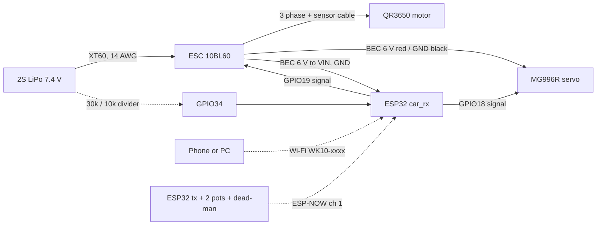

# WK-10: printable 1/10 on-road pan car

A rear-wheel-drive 1/10 on-road car you can print on the Ender 3 V3, built around parts I already had: the Shaluoman foam tires, an MG996R servo, two ESP32 dev boards, 685ZZ bearings from the 68 pc kit, the 3 mm stainless rods, the spring kit, the M3/M4 hardware and the heat-set inserts. You drive it from a phone, from Python, or from a second ESP32 used as a handheld transmitter. Purchases total about $285 with tax (itemised below).

Status 2026-10-12: designed, every part modelled and fit-checked in CAD, firmware compiles. Nothing printed or bought yet.


## Layout and why

| Decision | Choice | Reason |
|---|---|---|
| Class | 1/10 on-road pan car, 257 mm wheelbase, 164 mm track, 190 mm over the tires | Owned tires are 1/10 on-road (67 mm, 12 mm hex). 257 mm and 190 mm match the 1/10 GT bodies made for 190 mm pan cars (PROTOform Venturi GT, Bittydesign Ahura and P-GT3R). The first layout had a 175 mm track, 201 mm over the tires, which no 190 mm body covers. |
| Rear | Pivoting pod, solid 5 mm axle, locked spool | Printed differentials are the most reported failure in printable cars (PLA/PETG diffs soften, seize and click). A pod with a spool has no CV joints, no diff and one axle. A spool pushes slightly in tight corners on foam; acceptable for v1. |
| Front | Sliding-pillar kingpin (3 mm stainless rod, coil spring above the knuckle) | Uses owned rods and springs. Classic 1/12 pan car front end. |
| Steering | Servo horn pointing forward, both tie rods on one bolt 14 mm out; 16 mm knuckle arms angled about 17 degrees outboard | Solved numerically (`steering()` in `wk10.py`, each wheel tracked from straight-ahead, inner/outer named by turn direction): 98% Ackermann both ways (re-solved for the 164 mm track), 33 degrees of servo for 28 degrees of lock, 64 degree minimum transmission angle, 0.27 degrees of bump steer per 3 mm (1.49 degrees at the full 7 mm, toe-out both ways; a sliding pillar with a central servo cannot remove it). An earlier layout that looked right on paper (rearward horn, straight arms) was anti-Ackermann; the check now fails it. |
| Tie rods | Printed, two halves joined by a cut M3 stud in heat-set inserts | Replaces ball links and turnbuckles (saves $15). Loose 3.6 mm eyes on M3 bolts tolerate the tilt from 7 mm of bump over a 57 mm rod. Half a turn of the knuckle half changes the rod by 0.25 mm, about 1 degree of toe per wheel, so toe is set in 1 degree steps. Away from the eyes the bar is 6 x 5 mm (`BAR_H`): pinned-pinned Euler buckling at 403 N against the 77 N a stalled MG996R pushes through a 14 mm horn, safety factor 5.2. The first 6 x 3 mm draft buckled at 69 N. |
| Motor | Behind the rear axle | Ahead of the axle it collided with the pod pivot. Behind, it puts most of the weight on the driven wheels (CG from `review/data.json`), which matters because launch is traction-limited. |
| Body | PROTOform Venturi GT on four posts (front end and rear pod) | Polycarbonate at about 90 g beats any printed shell. Post tops are computed from the shell (skin + 9 mm, R-clip hole at +4). The rear posts ride the pod, so the rear body holes are fore-aft slots. Arches are cut 9 mm over the tire, stretched 12 mm fore and aft for steering lock, and open to the skirt. The shell's hood and deck heights are not published: the model is sized to the published 430 x 191 x 258 WB, so offer it up before trimming anything. |
| ESP32 | Printed cradle + lid | The DevKitC V4 has no mounting holes and its header pins hang 8.5 mm under the board. It sits on two end ledges between the pin rows, the lid's pad stops 0.2 mm above the module shield, and the six leads are soldered to the pins. Base on servo tape. |
| Pan | Split at X=86 mm, joined by a splice block that also carries the servo | 240 mm pan does not fit a 220 bed even diagonally. |
| Control | Car ESP32 is its own Wi-Fi access point (phone joystick, tuning page, HTTP API) plus ESP-NOW for a second ESP32 transmitter | No radio purchase. Every source goes through one failsafe. |

## Performance (mechcalc `vehicle` engine, deterministic)

Inputs: 1.24 kg, 67 mm tires, Hobbywing QR3650 3600 Kv on 2S, 14T/87T 48P (6.21:1), CG 30 mm high, 58% rear.

| Metric | Value |
|---|---|
| Top speed | 52.6 km/h |
| 0-30 km/h | 1.33 s |
| 0-50 km/h | 2.93 s |
| Peak current | 60 A (pack can source 416 A) |
| Motor heat, continuous | 18 W |
| Runtime | 8.9 min at continuous 35 A, so real runs (part throttle) last longer |
| Lateral tip-over | 2.9 g, so it slides long before it rolls |

Launch is traction-limited: about 8 N of rear grip against 25 N of thrust. The firmware ramps throttle at 4 full-scale per second, and `maxThrottle` starts at 0.5 until you raise it from the phone.

Gearing with the 13T to 17T pinion set (all fit the motor slots, which give 1.5 mm each way):

| Pinion | Ratio | Centre distance | Use |
|---|---|---|---|
| 13T | 6.69 | 26.45 mm | Small lot, more punch |
| 14T | 6.21 | 26.72 mm | Default, about 53 km/h |
| 15T | 5.80 | 26.98 mm | About 56 km/h |
| 17T | 5.12 | 27.51 mm | Long straights; watch motor temperature |

Mass budget (g): printed parts 215, motor 180, ESC 80, battery 250, servo 55, wheels/hubs/axles 225, ESP32 + wiring 40, body 120, hardware 40. Total about 1240 g. CG X -21 mm, Y -0.8 mm, Z 29 mm.

## Bill of materials

### To buy (checked 2026-10-12, Amazon delivering to 32246 unless noted)

| Part | Pick | Why this one | Price |
|---|---|---|---|
| Motor + ESC | [Hobbywing QuicRun 10BL60 SD G2 + QR3650 SD 10.5T G2](https://store.hobbyetc.com/parts/view/181393) | Only combo whose BEC is confirmed: 6 V at 4 A runs the MG996R and the ESP32. 3600 Kv, 36 x 52.8 mm, 3.17 mm shaft, ESC 35 x 31 x 30.8 mm. Hobbyetc, free shipping over $49 (asterisked on their page) | $89.99 |
| 2S LiPo | [Zeee 5200 mAh 80C XT60, 2-pack](https://www.amazon.com/dp/B08DCYVHSF) | 138 x 47 x 25 mm fits the 47.5 mm bay; XT60 matches the owned pigtails | $35.99 |
| Charger | [SkyRC B6AC Neo](https://www.amazon.com/s?k=SkyRC+e450+charger) (ASIN B0CV64ZB2L) | AC built in, 60 W AC / 200 W DC, real brand | $53.00 |
| LiPo bag | [Zeee bag 28 x 22 cm](https://www.amazon.com/dp/B0FWBMK87X) | Charge and store in it. Do not use the salvaged LiPo lot for this car | $6.29 |
| Pinions | [ShareGoo 48P 13T to 17T, 5-pack](https://www.amazon.com/s?k=48P+pinion+set+13T+17T) (ASIN B09FGC6JV4) | Gearing range in one buy | $11.49 |
| Spur | [Kimbrough #148 87T 48P](https://www.amazon.com/dp/B0006O1QW6) | Nylon. Its bolt pattern is not published, so the printed `spur_clamp` is the drilling template | $9.13 |
| 5 mm rod | [304 stainless 5 x 300 mm, 5 pcs](https://www.amazon.com/s?k=5mm+x+300mm+stainless+steel+rod+2+pcs) (ASIN B0D5D2H1KJ) | Rear axle 200 mm, two front stubs 46 mm, spares | $8.99 |
| Shaft collars | [5 mm bore, 10 mm OD, 12 pcs](https://www.amazon.com/s?k=5mm+bore+shaft+collar+set+screw+10+pcs) (ASIN B0F9P5CNSL) | Wheel retention and axle end float | $5.99 |
| Battery strap | [Hobbypark 20 x 200 mm, 6 pcs](https://www.amazon.com/s?k=20mm+hook+and+loop+battery+strap+rc+lipo) (ASIN B08HHHFMCJ) | | $6.97 |
| Body | [PROTOform Venturi GT](https://www.amazon.com/dp/B0CDZ1FSXN) | 190 mm class (191 wide), 430 long, 258 mm wheelbase, wing included, clear with decals. Paint optional | $29.99 |
| Body clips | [Traxxas 1834 body clips (12)](https://www.walmart.com/ip/37293444) | R-clips for the four posts | $6.95 |
| **Total** | | | **$264.78, about $284.64 with 7.5% Duval tax** |

Headroom under $300 is about $23. Cheaper route if you want it: the Surpass 3650 3500 Kv/60 A combo ($42.95, [B0FWQHQJT1](https://www.amazon.com/dp/B0FWQHQJT1)) and a PUSLAKO B6AC clone charger ($33.99) bring the total to about $206 with tax, but neither Surpass listing confirms a BEC strong enough for the MG996R. If you take that route, power the servo from a separate 6 V BEC.

Not needed any more: ball links and turnbuckles (printed tie rods), the Hobbypark hubs (they need an M4-threaded axle tip; printed `hex_hub` replaces them).

### Already owned

| Part | Qty | Used for |
|---|---|---|
| Shaluoman 1/10 on-road foam tires + rims (67 x 26 mm, 12 mm hex, 3 mm offset) | 4 | Wheels |
| Deegoo MG996R servo | 1 of 4 | Steering |
| ESP32 dev board | 2 of 4 | Car brain, optional handheld transmitter |
| 68 pc bearing kit, 685ZZ (5x11x5) | 6 | 2 per knuckle, 1 per pod plate. Count the 685s; the kit's split is not listed |
| Lyrlidr 3 mm x 300 mm stainless rod | 1 | Two kingpins at 47 mm |
| Ladinka 304 SS spring kit | 3 | Two kingpin springs (ID 5.5 to 6.5 mm so they pass over the bump-stop sleeve, about 16 mm free so they preload into the 14 mm gap). One rear pod spring: ID 3.6 mm or more, OD 9 mm or less, free length 27 mm or more, about 3 N/mm (it carries about 9 N at ride height; see assembly step 12). If the kit has nothing that long and stiff, two shorter springs stacked on the bolt with a washer between them work. |
| uxcell M4 shoulder bolt, 5 x 10 mm shoulder | 2 | Pod pivot (the shoulder is the bearing) |
| FFVRVSS heat-set inserts | about 40 M3, 2 M4 | Every printed joint, tie-rod halves |
| Fgruh M3 kits | about 60 screws + nuts | Button heads under the pan, M3x35 for the pod spring, two M3x20 cut to studs for the tie rods |
| MOGAOPL resistor kit | 30k + 10k, 2 x 4.7k + 2 x 2.2k | Battery voltage divider (optional), transmitter pot end resistors |
| inShareplus 6V 10A supply | 1 | Bench power for the servo during bring-up, before the ESC is wired |
| WH148 potentiometers (10k), tact switch, 2 x 4.7k + 2 x 2.2k resistors | 2 + 1 + 4 | Handheld transmitter (optional) |
| RioRand XT60 pigtails, 14 AWG silicone wire, heat shrink | as needed | Battery lead |
| AIO PETG (500 g) | about 100 g | Knuckles, pod, spool, hubs, tie rods |
| PLA | about 150 g | Pan, front end, braces, trays |

## Printed parts

`cad/out/print/` holds a print-ready STL for every part, already rotated into its slicer orientation and sitting on Z=0, plus `calibration_coupon.stl`. `cad/out/` holds the same parts in assembly pose as STEP and STL, and `wk10_assembly.step` is the whole car. STLs are regenerated, not committed. Regenerate everything and re-run the fit checks with:

```bash
python cad/wk10.py
```

Print the calibration coupon first (PETG, same settings as the bearing parts). Measure every hole with the Kynup caliper. The hole compensation in `wk10.py` (`HOLE_COMP = 0.2`) is an assumed default, not this printer. Change that one knob until a 685ZZ drops into the 11.2 mm hole with a light press, then re-run. Layer height 0.2 mm for everything.

Every part below was run through the printability analyser in its print orientation (2026-10-12). "Support" lists the only places that need it.

| Part | Qty | Material | Settings | Support |
|---|---|---|---|---|
| calibration_coupon | 1 | PETG | 100% infill | none |
| pan_rear, pan_front | 1 each | PLA | 5 walls, 40% gyroid | pan_rear: under the rear spring arm only |
| splice_servo_block | 1 | PLA | 5 walls | none |
| front_end | 1 | PETG or PLA | 6 walls | none |
| upper_arm_L, upper_arm_R | 1 each | PLA | 5 walls | none |
| knuckle_L, knuckle_R | 1 each | PETG | 100% infill | tree supports from the bed under the steering arm and the web; none inside the bearing seats (the 2 mm ring ceiling bridges) |
| tie_rod_L/R_horn, tie_rod_L/R_knuckle | 1 each | PETG | 100% infill | none |
| pod_plate_L, pod_plate_R_motor | 1 each | PETG | 100% infill (the motor plate takes the heat) | none |
| pod_floor | 1 | PETG | 5 walls, 40% | under the pivot lug only |
| pod_brace | 1 | PLA | 5 walls | none |
| spool | 1 | PETG | 100% infill | none |
| spur_clamp | 1 | PETG | 100% infill | none |
| hex_hub_x4 | 4 | PETG | 100% infill | none |
| bump_stops | 2 | PETG | 100% infill | none |
| race_shims_x4 | 4 (3 used) | PETG | 100% infill; 6.5 mm OD so it only touches the inner race, check it clears the bearing shield | none |
| spring_shims_x3 | 1 set | PETG | 100% infill | none |
| esp32_cradle | 1 | PLA | 3 walls | none |
| esp32_lid | 1 | PLA | top face down | none |
## Assembly order

1. Heat-set every insert first (Hakko at about 210 C), square to the face.
2. Press 685ZZ bearings into both knuckles and both pod plates. If a seat is loose, a drop of CA; if tight, warm the part.
3. Pan: lay both halves face down, drop the splice block over the joint, eight M3 button heads up from below into its inserts.
4. Front end: four M3 button heads up through the pan. Cut two 47 mm kingpins from the 3 mm rod, deburr, press into the lower arm bosses (drill the boss to 3.0 mm first; it prints about 2.8).
5. Slide each knuckle onto its kingpin, then the bump-stop sleeve and the spring, then bolt the upper arm down so the kingpin passes through its boss. The spring should be preloaded 2 to 3 mm at ride height.
6. Front axles: grind a 0.5 mm flat on each 46 mm stub where the hub's set bolt lands (Fanttik rotary tool). There is no room for a collar inside the knuckle, so the stub is held by its bearings: put a drop of retaining compound or thin CA on the stub where the INNER bearing's race sits, slide it through both bearings, then a race shim, the hex hub (set bolt on the flat, pushed against the shim), the wheel, and a collar outboard. The inner bearing's seat shoulder stops the axle pulling out; the shim and hub stop it pushing in.
7. Servo: drop into the splice pocket, M3 into the ear-post inserts. Centre it from the phone page (bring-up step 3) before fitting the horn, then fit the horn pointing straight FORWARD. Drill the horn hole nearest 14 mm from the spline to 3.0 mm for the M3 pivot bolt.
8. Tie rods: cut the heads off two M3x20 screws, thread each stud halfway into a horn half, then screw the knuckle half on. Both horn eyes stack on one M3 bolt through the horn, left rod underneath. Knuckle eyes bolt into the steering-arm post inserts. Set equal lengths (56.7 mm eye to eye) to start.
9. Pod: stand the plates on the floor against the floor rails and bolt them sideways into the rail inserts (3 M3 on the left plate, 2 on the motor plate). Brace between the plates (2 M3 sideways). Motor on the right plate through the slots, 14T pinion on the motor shaft.
10. Spur: drill its centre to 12.2 mm. Tape `spur_clamp` to it as a template and drill the three holes at 3.2 mm. Sandwich spur between the spool flange and the clamp ring with three M3x12 bolts and nuts.
11. Rear axle: grind one 0.5 mm deep flat along the 200 mm rod where the spool sits (about 20 mm long) and short flats where the two hubs land. Slide it through the left bearing, the right bearing and the spool (the spool's D-bore keys on the flat). Shaft collars: one outboard of the left plate with a race shim between it and the bearing (so it touches the inner race only), one outboard of the spool. Push them together so the axle has no end float. Set mesh with a strip of paper between the gears, tighten the motor screws.
12. Hang the pod on the pan with the two M4 shoulder bolts into the pod's M4 inserts (0.3 mm of float each way, so it never clamps). Rear spring: spring shims on the pod-floor seat, then the spring, then the M3x35 (two washers under the head) down through the pan's spring arm into the seat insert. Put the car on its wheels with the battery in and add or remove shims until the pan's rear edge sits 5 mm off a flat table. The spring carries about 9 N there, so with a 3 N/mm spring it is preloaded about 3 mm. The CAD check proves the pan's rear edge still clears the ground (1.3 mm) at 4 degrees of pod swing; a spring that is too soft lets it bottom.
13. Battery in the left bay with the strap through the slots, leads out of the front end, between the pack and the servo block. ESC fan-up on servo tape on the right, behind the ESP32 cradle. Solder six leads to the DevKitC pins (GPIO18, GPIO19, GPIO34, VIN, two GND), lay the board on the cradle ledges with USB to the rear, and screw the lid down.
14. Body: put the painted shell on with the wheels straight, mark where the posts touch, and trim each post to 9 mm above the skin before drilling the R-clip hole 4 mm above it. The rear holes are slots because the rear posts move with the pod.

## Wiring



- Set the 10BL60's BEC to 6 V (its programming card or button menu), not 7.4 V: the MG996R is rated to 6 V.
- The BEC powers both the servo and the ESP32. Feed it to the board's VIN/5V pin, which goes through the onboard 3.3 V regulator. Never connect the pack or the BEC to 3V3. Check your dev board's regulator accepts 6 V (AMS1117 boards do).
- Signal wires: ESP32 3.3 V logic drives standard servo and ESC inputs. GPIO18/19 avoid the strapping pins (0, 2, 5, 12, 15) and the flash pins (6 to 11).
- Battery divider (optional): pack + to 30k to GPIO34 to 10k to GND, and set `VBAT_RATIO = 4.0` in `car_rx.ino`. Max 8.4 V reads 2.1 V at the pin. It draws 0.2 mA, so unplug the pack after a run (you should anyway). Without the divider leave `VBAT_RATIO = 0` (the default): GPIO34 floats, and a floating pin would read random voltages and could trigger limp mode.
- Main lead 14 AWG, motor leads as short as the pod allows, kept away from the ESP32 antenna.

## Firmware

Three files, Arduino-ESP32 core 3.x:

- `firmware/car_rx/car_rx.ino` runs on the car.
- `firmware/tx/tx.ino` runs on the optional handheld transmitter.
- `firmware/libraries/WkLink/WkLink.h` holds the radio packet, the tuning record, the control maths, the arming gate, input validation and the self-test.

Both sketches compile (car 77% of flash, transmitter 68%):

```bash
arduino-cli compile --fqbn esp32:esp32:esp32 --libraries firmware/libraries firmware/car_rx
```

The same `wk_selftest()` the car runs at boot also runs on the PC, against the defaults and an asymmetric, reversed, trimmed config. It passes, and three deliberately broken copies of the header (gate that never disarms, slew that ramps from reverse, neutral range widened to 1630 us) each fail it. Rebuild and run it with zig's bundled C++ compiler (project venv, `pip install ziglang`):

```bash
python -m ziglang c++ -std=c++17 -w -I firmware/libraries/WkLink firmware/test/host_selftest.cpp -o build/selftest.exe
```

```bash
build/selftest.exe
```

### Ways to drive

1. **Phone.** Set `AP_PASS` in `car_rx.ino` (8+ characters; the access point stays off while it reads `CHANGE-ME`). Join Wi-Fi `WK10-xxxx`, open `http://192.168.4.1`. Hold a finger on the pad: up is throttle, sideways steers, lifting the finger stops the car. The car only arms after it has seen the dead-man released; the idle page already sends that, so it arms as soon as the page connects (the status line says `release to arm` if not). Switching apps or locking the phone counts as lifting the finger.
2. **Python.** On the same Wi-Fi: `python tools/drive.py figure8` drives a 16 second figure-eight at quarter stick (times `maxThrottle`). Write your own `program(t) -> (steer, throttle)` and pass it to `run()`, which arms the car, sends at 20 Hz with rising sequence numbers, aborts loudly if the car ever leaves web control (a slow request lets the failsafe fire and disarm it), and stops the car however the script ends. `python tools/test_drive.py` checks those three behaviours against a fake car on localhost (it passes; it does not test real Wi-Fi latency). Use one web client at a time: the phone page and a script share one sequence counter, and whichever sends the higher number wins. The API is `GET /drive?s=<-1000..1000>&t=<-1000..1000>&d=<0|1>&n=<rising integer>`. A request with an `n` lower than one already seen gets 409 and is ignored. After 1 s with no web commands any `n` is accepted again (the car has already failed safe and disarmed by then), and requests without `n` are always accepted. `GET /state` returns pulses, arming, battery voltage and source.
3. **Handheld transmitter.** Second ESP32 with two pots and a dead-man button over ESP-NOW. Wire each pot 3V3 -> 4.7k -> pot -> 2.2k -> GND (10k pots from the WH148 kit) so the travel sits at about 0.43 to 2.38 V, inside the 0.15 to 2.45 V range the ESP32's ADC calibration covers. The transmitter prints the pot millivolts on serial; turn each knob to both stops and put the readings in `MV_MIN` / `MV_MAX`. A reading 150 mV beyond a stop, or a raw reading pinned at either rail (an open GND or 3V3 lead), means a broken wire, and the transmitter sends stop instead of full lock or full throttle. Bench-test it by pulling each pot lead in turn. While it is talking it overrides the phone and API. When it drops out the car goes to failsafe, and the phone has to be released and pressed again to take over.

### Tuning without reflashing

The phone page's Tuning section edits every setting and saves it to flash: steering centre/endpoints/reverse/expo, ESC neutral/forward/reverse limits, throttle slew, `maxThrottle` and failsafe time. It only accepts changes while the car has been commanded to neutral for 3 s (no throttle, dead-man released); otherwise it answers 409. There is no wheel-speed sensor, so a coasting car counts as stopped: stop it before you tune it. Every value is range-checked on the car (`wk_cfg_valid`) and out-of-range values are rejected with a 400. `escNeutral` is limited to 1470..1530 us and takes effect at the next boot, because the ESC armed on the old value. "Defaults" restores the shipped values. Firmware updates can go over Wi-Fi (Arduino OTA, password = `AP_PASS`); OTA only listens after 5 s with no valid command, so close the phone page first (its idle stream counts as commands). Once an upload starts, the control task forces neutral and ignores every command until the reboot.

### Safety

- A dedicated control task (priority 10, 100 Hz) is the only thing that writes the servo and ESC pulses, and it owns the failsafe. The web server and OTA run in `loop()`, which can block for seconds on a bad TCP connection, and they only hand commands over under a spinlock. A control task that stops running for 300 ms trips the task watchdog. The watchdog interrupt immediately detaches GPIO19 from LEDC and holds it low, so the ESC loses its signal and goes to its own failsafe, and then the chip resets (the core dump that follows no longer matters). While an OTA upload or a settings save is writing flash (car parked, neutral forced) the timeout is relaxed to 5 s, because flash erases stall the CPU.
- No valid command for 250 ms (configurable 100 to 500 ms) sets neutral throttle and centre steering. The pulses keep running, so the ESC sees neutral instead of a frozen value.
- Arming gate: throttle passes only after the dead-man has been seen released on the current source since boot, since the last failsafe and since the last source change. A brownout reboot mid-run with the trigger held does not launch the car.
- Throttle is zero unless a dead-man is held: TX button, finger on the phone pad, or `d=1` in the API.
- `maxThrottle` caps forward power and starts at 0.5. Reverse is capped at half. Reverse to forward ramps from zero.
- ESC calibration mode sends the true 1000..2000 us end points with no caps, because an ESC learns whatever it sees at full stick as 100%; calibrating with the caps active would turn 50% into full power. It can only be started from the phone page while the phone is driving and the car is parked, lasts 30 s, ends at once if the phone loses control or the transmitter takes over, has an End button, and blinks the LED in short flashes. Throttle beyond 90% snaps to 100% so the ESC sees the real end point. `drive.py` refuses to drive while it is active.
- If the pack sags below 3.4 V per cell for 2 s under load, throttle is capped at 30% until power-cycle (needs the divider).
- The car arms the ESC on the saved neutral for 3 s at boot, and every stop uses that same pulse.
- `wk_selftest()` runs at every boot against the config in use. A failure parks the car at neutral and fast-blinks the LED.
- Transmitter packets are accepted only from the MAC in `TX_MAC`, with a valid checksum and a newer sequence number than the last one (any number after 1 s of silence, by which time the car has failed safe and disarmed). While `TX_MAC` is all zeros the car ignores every transmitter and prints the MAC of anything it hears. The transmitter refuses to broadcast.
- The Wi-Fi is WPA2 with your password. Anyone with it can drive the car, so do not reuse a real password. ESP-NOW packets are not encrypted; MAC binding plus sequence numbers stops accidents and replays, not a determined attacker spoofing your transmitter's MAC.

Alternative controller: a PS4/PS5/Switch pad through [Bluepad32](https://github.com/ricardoquesada/bluepad32) would give a sprung trigger. Not built; it needs Bluepad32's own board package and is undocumented alongside ESP-NOW.

## Bring-up (bench, wheels off the ground)

1. Set `AP_PASS`, flash `car_rx`, open serial at 115200. It must print `selftest: pass` and the car MAC.
2. Servo horn off. Power the ESP32 from USB and the servo from the 6 V bench supply (servo red to +6 V, black to supply minus AND to an ESP32 GND pin, signal to GPIO18). No ESC yet. Join the Wi-Fi, open the page, confirm the servo follows your finger.
3. In Tuning, move `steerCenter` until the servo sits where the horn can go on pointing straight forward. Fit the horn, then the tie rods.
4. Move `steerLeft` / `steerRight` inward until the inner wheel stops just short of 28 degrees of lock, about 35 degrees of servo (the CAD sweep is cleared to 28 degrees with 3.3 mm to spare). Servo buzzing at full lock means the endpoint is too far. Save.
5. Pinion off, wheels off the ground. Disconnect the bench supply, connect the ESC and battery (BEC set to 6 V, now powering servo and ESP32). Put the ESC into its throttle-calibration mode first, as its manual says (on many ESCs that means holding SET while switching on, which also reboots the ESP32). Wait for the phone page to reconnect and the car to sit parked for 3 s, press "ESC calibration mode (30 s)", then give the ESC the neutral, full forward and full reverse it asks for with the pad. Press "End calibration". Check the motor spins the right way, or set direction in the ESC.
6. Failsafe tests, wheels in the air: drive at low throttle and (a) lift your finger, (b) switch the phone's Wi-Fi off, (c) Ctrl+C `drive.py`, (d) pull the ESP32's USB/BEC lead and plug it back while holding the pad. The motor must stop within a quarter second every time, and after (d) it must not move until you release and press again. Do not drive until all four pass.
7. Pinion on, mesh set, first floor run with `maxThrottle` at 0.3.
8. Optional transmitter: flash `tx` with `CAR_MAC` set, read its MAC from serial (or from the car's `ignored ESP-NOW from` line), put it in `TX_MAC`, reflash the car, repeat the failsafe test by unplugging the transmitter.

## Test plan

| Test | Pass | Result |
|---|---|---|
| Host self-test | `host selftest: pass` | pass, 2026-10-12 |
| Boot self-test | `selftest: pass` on serial | [ ] |
| Failsafe (finger up, Wi-Fi off, script killed, ESP32 reset while held, TX unplugged) | Motor stops within 250 ms each time and does not restart until released and pressed again | [ ] |
| drive.py against a fake car | `test_drive: pass` | pass, 2026-10-12 |
| Rear ride height | Pan rear edge 5 mm off the table, car on its wheels with battery | [ ] |
| Range, open lot | Phone and TX keep `src` live at the far end; ESP32 PCB antennas are rated under about 150 m | [ ] |
| Tracking | Straight 10 m at half throttle after trim | [ ] |
| Steering | No servo buzz at either lock; no wheel-to-chassis contact at lock with suspension compressed | [ ] |
| Heat, after a 5 minute run | Motor and motor plate under 60 C, ESC under 70 C | [ ] |
| Runtime | Minutes to the ESC cutoff; prediction 8.9 min at full load | [ ] |
| Top speed | Timed 20 m pass; prediction 52.6 km/h on 14T | [ ] |

## Known gaps

- Fit checks (`checks()` in `wk10.py`, run on every build) cover:
  - nothing overlaps anything in the assembled pose, printed parts and the bought parts, which are modelled from the makers' dimensions in `cad/bought.py` (tires and rims, QR3650, 10BL60 G2 ESC, MG996R and horn, ESP32-DevKitC V4 and its pins, 2S pack, 87T/14T gears, axle, kingpins, collars, the Venturi GT shell, windows and wing); meshing gear teeth are the one pair allowed to touch;
  - the body shell clears the tires at full lock, +7 mm bump and -5 mm droop, and the front wheel stack-up (bearing, race shim, `HUB_COLLAR`, rim hex) lands the wheel centre on track / 2;
  - wheel and knuckle sweep to 28 degrees of lock (4.0 mm min gap, body on);
  - front travel +7/-5 mm at straight and full lock (1.5 mm);
  - rear pod swing of 4 degrees each way (1.1 mm min gap to the pan, pivot lugs excluded), the pivot lugs' 0.3 mm side float, and the pan's rear edge still 1.3 mm off the ground at that swing;
  - steering linkage in both directions: both wheels turn the same way, Ackermann 70 to 130%, servo throw 25 to 45 degrees, transmission angle over 40 degrees, bump steer under 0.5 degrees per 3 mm and under 1.6 degrees at full travel;
  - motor clear of the axle, spur and motor ground clearance, bed fit (two smallest dimensions within 215 x 245) and solid validity.

  - the real printed tie rods (eyes, bar and joint boss) at both full locks clear the chassis, the servo, the other knuckle and both turned wheels (5.3 mm min gap).
  - tie-rod buckling: Euler load at least 2x the servo stall push (`SERVO_STALL_NM`, currently 5.2x).

  They do not cover the real rim hex depth (not published, measure it), the real body's hood and deck heights, the body during pod swing, lead routing, spring solid height, or the tie rods during bump.
- Listing values to measure on arrival: MG996R ear-hole spacing (49.5 mm) and ear height (26.6 mm on the components101 drawing), horn top height (`HORN_TOP_Z` 56 mm), spur thickness (`SPUR_W` 6 mm), motor hole spacing (540 standard 25 mm, not stated by Hobbywing). Each is one knob in `wk10.py`.
- The firmware has not run on hardware. The self-test proves the maths, not the wiring or the radio.
- The front has no damping beyond spring friction, and the rear pod has one spring and no damper. Fine on smooth pavement.
- Locked rear axle: expect push in tight turns. v2 path is a bought steel 1/10 gear diff in the spool's place (EXPLORER-MK1 uses HSP 02024/03015 parts).

## Reference builds

Researched 2026-10-09:

- [OpenRC F1](https://www.printables.com/model/2714-openrc-f1-car-110-rc-car) (CC BY-SA): print-settings baseline.
- [DKS-Basic 1/10](https://www.printables.com/model/447947-chassis-110-adaptable-dks-basic) (CC BY): solid driven rear axle, brushed 540 + QuicRun 1060. Community mods found 3900 Kv too fast.
- [EXPLORER-MK1](https://www.printables.com/model/691100) (CC BY-NC): 257 mm wheelbase, 1.4 kg, 50 km/h. Closest geometry; source of the steel-diff upgrade path.
- [Tarmo5](https://www.printables.com/model/348623) (CC BY-NC-SA): joint slack and CV wear reports shaped the no-CV, no-diff choice.

Nothing here copies geometry from these; they set the targets and the failure list.
