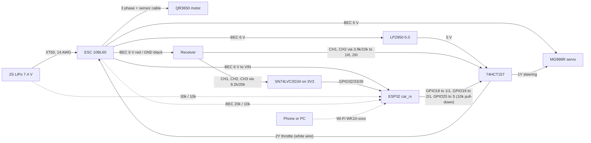

# Firmware rev F: hobby radio primary, ESP32 behind a hardware mux

Status 2026-10-13: both sketches compile with no warnings, host self-test and `test_drive.py` pass, after one independent review round (fixes in "Review round 1" below). Nothing has run on hardware.

## What changed

**Control model.** A hobby 2.4 GHz pistol radio is the primary link. A 74HCT157 sits between the receiver and the servo/ESC: select S low passes receiver CH1/CH2, S high passes ESP32 GPIO18/19. S is GPIO25 with an external 10k pull-down, so a dead, resetting, booting or unflashed ESP32 always leaves the receiver in charge. The ESP32 raises S only when all of these hold:

- receiver CH3 has two consecutive valid pulses of 1800 to 2200 us (autonomy position), the newest fresher than 100 ms;
- receiver CH1 and CH2 both have valid pulses (800 to 2200 us) fresher than 100 ms;
- the control step ran no more than 50 ms after the previous one;
- an ESP32 command source (phone, script or legacy TX) is fresh (under `failsafeMs`) and armed (dead-man seen released);
- the commanded throttle is zero at the moment of engaging;
- this step's pack and BEC samples are readable and plausible, the low-battery latch is clear, the last rested reading is 3.7 V/cell or more and under 60 s old, and the BEC is 6.5 V or less;
- all of the above have held continuously for 500 ms.

**Which failsafe wins when.**

| Event | S | Who stops the car |
|---|---|---|
| Receiver failsafe with no pulses, receiver unplugged, CH1/CH2 stale | low in the same 10 ms step | Receiver failsafe, or the ESC's own signal-loss cut if the receiver outputs nothing |
| Receiver failsafe that outputs preset pulses | low, because the receiver failsafe must put CH3 on manual (radio setup below) | Receiver failsafe values (set CH2 to brake) |
| Receiver that can only "hold" on signal loss | stays high: CH1/CH2/CH3 keep arriving at their last values, so the ESP32 cannot see that the transmitter is gone | The ESP32's own command failsafe only. Do not use such a radio for autonomy |
| CH3 flipped to manual | low at the next gap where all four signals are low (one receiver frame, 50 ms at most) | The driver |
| Pack latch (under 3.3 V/cell for 2 s), 5 bad pack/BEC samples in a row | low in the same step, buzzer alarm | The driver |
| Control task late by more than 50 ms | low on the next step | The driver |
| Control task stalled 300 ms | watchdog ISR drives GPIO25 low and cuts GPIO19, then the chip resets (pin returns to the pull-down) | The driver |
| Control task cannot join the watchdog at boot | never raised | The driver |
| OTA upload or settings save | low in the same step (`inhibit`) | The driver |
| Only the ESP32 command source lost (phone Wi-Fi drop, script killed), receiver fine, CH3 on autonomy, and the ESC would brake (below) | stays high for `brakeMs` (3 s max) while the ESP32 sends the brake pulse, then low at the next common gap | ESP32 brake first, then the driver. Flipping CH3 to manual ends the brake |
| Same, but the ESC might take below-neutral as reverse | low at the next common gap, neutral pulse, no brake | The driver |

The ESP32 brake wins only in the one case where nothing else is wrong and the driver's trigger is probably at neutral (which would coast). This is one deliberate reading of "S high only when the command source is fresh": S is never raised without a fresh source, but it is held for the brake window after the source goes stale.

**ESC direction tracking and the failsafe brake.** `wk_esc_track()` follows what the ESC has actually seen (the ESP32 pulse while S is applied high, receiver CH2 while it is low) through the Hobbywing Fwd/Rev/Brake rules: after forward, the first push below neutral brakes, also after a return to neutral; once it has braked, neutral then below reverses. States: unknown, forward, braking, after-brake, reverse. A pulse above escNeutral + 40 us is forward; below escNeutral - 10 us may be "below neutral"; at or above escNeutral - 40 us may be neutral; a pulse between -40 and -10 us counts both ways, always against braking. No signal, and every S change (the switch can land mid-frame), reset it to unknown. The ESP32 itself never sends a throttle pulse between escNeutral - 40 and escNeutral - 1 us: those are snapped to neutral, so the ESC can never read one of ours either way.

`wk_brake_ok()` decides whether the failsafe may send the brake pulse, by `escMode`:

| `escMode` | ESC running mode | Failsafe on command loss |
|---|---|---|
| 0 (default) | Forward/Reverse with Brake | Brake only if the tracker says forward, or braking continuously since forward (a held brake keeps braking). Otherwise neutral and hand back |
| 1 | Forward with Brake (no reverse) | Always brake: below neutral can never reverse |
| 2 | Forward/Reverse, no brake (crawler) | Never brake: below neutral is always reverse. Neutral and hand back |

Read the running mode from the ESC's programming card or button/LED menu (the "Running Mode" item on Hobbywing car ESCs) and set `escMode` to match. The ESC's own neutral range must be narrower than 40 us each side of neutral, or the band assumption breaks; if its manual says otherwise, raise `WK_ESC_BAND_US` in `WkLink.h`.

Brake pulse is `wk_esc_us(cfg, escNeutral, -brakeFrac)`, default 35% of the configured reverse span (escNeutral 1500 to escRevMax 1250, so 1413 us). `wk_cfg_valid` rejects a brake pulse inside the neutral band (it would read as neutral, and as "parked", during the brake) and `brakeMs` over 3000. `brakeFrac = 0` or `brakeMs = 0` turns the brake off (coast, then S low).

**S changes in a common low gap.** `wk_control_step` returns the wanted S and an `urgent` flag. Urgent (receiver lost, battery latch, sensor fault, late loop, OTA or flash write) is written to the pin in the same step. Anything else (engaging, CH3 to manual, brake end, command lost without brake) is applied by the CH2 falling-edge interrupt, when CH2 has just ended and CH1 and the ESP32's GPIO18/19 pads (input enabled, so the LEDC level reads back) are all low. That avoids cut or merged pulses. If no such gap comes within 50 ms the control task forces it. LEDC is not phase-locked to the receiver; residual: at a switch the servo and ESC can see two pulses closer together than one frame period (never a cut or merged pulse), and a forced switch after 50 ms can still cut one.

**Pure control function.** Source selection, the arming gate, mux decision, brake decision and timing, ESC tracking, battery gates, steering limits, alarms, receiver edge decoding and the web lock live in `firmware/libraries/WkLink/WkLink.h`: `wk_control_step(WkCtl &state, const WkCfg &, const WkIn &, uint32_t now) -> WkOut`, `wk_esc_track()`, `wk_brake_ok()`, `wk_edge()`, `wk_lock_accept()`. The sketch only reads inputs and writes pins. `WkOut.why` is a bitmask of every reason S is low (`WK_WHY_*`), reported on `/state`.

**Receiver capture.** CH1/CH2/CH3 on GPIO32/33/26 with one CHANGE interrupt each, timed with `micros()`, level read straight from `GPIO.in`/`GPIO.in1`, decoded by `wk_edge()`. A width counts only for the first fall after a rise, and only if that rise came at least 2.5 ms after the previous fall, so a stray interrupt can drop a pulse but never invent or stretch one. `prevUs` holds the previous width only if nothing was rejected in between; CH3 needs both in the autonomy window. Interrupts rather than RMT: RMT's glitch filter would help against short spikes, but its receive-and-rearm cycle under Arduino core 3.x cannot be verified without hardware, while `wk_edge()` is pure and tested on the host. Pins: GPIO32/33/26 are input-capable, not strapping (0, 2, 5, 12, 15), not flash (6 to 11), and not GPIO36/39 (ESP32 erratum: spurious interrupts while the ADC and Wi-Fi run). No internal pull: every input option below has its own resistor to GND.

**Battery and BEC.** The pack divider is mandatory (GPIO34, 30k from the pack, 10k to GND, 100 nF at the pin). The BEC monitor is on GPIO35 (20k/10k, 100 nF). Both ratios are stored calibration constants in flash (`vbatRatio` default 4.0, `becRatio` default 3.0), editable from the tuning page. One `analogReadMilliVolts()` per pin per step; under 50 mV or over 3000 mV is a bad sample. A bad or implausible sample (pack outside 2.5 to 4.5 V/cell, BEC outside 3 to 9 V) blocks engaging at once and is left out of the filter; 5 in a row release S and alarm. Pack under 3.3 V/cell for 2 s latches until power-cycle (bad samples do not reset that timer). "Rested" is the filtered reading after the ESC has seen neutral for 2 s; braking never counts as neutral.

**Outputs.** External status LED on GPIO23 (solid = ESP32 driving, 10 Hz flicker = ESP32 braking, 1 Hz = radio driving, 4 Hz = receiver missing or battery fault). Passive piezo on GPIO22 driven at 2.7 kHz by LEDC: battery alarm = 0.5 s beeps, link lost = 5 Hz beeps, autonomy engaged = two chirps. Alarms sound only after the receiver has been seen once since boot, so a USB-only bench stays quiet.

**Phone driving.** HTTP polling replaced by a WebSocket on port 81 (library: WebSockets by Markus Sattler 2.7.2, installed with `arduino-cli lib install WebSockets@2.7.2`; it lives in the Arduino user library folder, not in this repo). The page streams text frames at 50 Hz, fire and forget (it skips a frame instead of queueing when `bufferedAmount` is non-zero). Relative joystick: touch anywhere, slide up from that point for throttle and sideways for steering, full scale at 30% of the pad width; the stick gives no reverse. A separate BRAKE / REVERSE bar sends full negative throttle while held (brake, or reverse on the second press per the ESC). Either touch counts as the dead-man. The car pushes state every 200 ms; the page shows it, including "LOCKED" when another client holds the lock. WebSocket heartbeat (1 s ping, 2 misses) drops a phone that left range.

**Single-client lock.** Phone and scripts share one lock: frames carry a random 32-bit token and a rising sequence number. The token holding the lock is accepted only with a newer seq; any other token is refused until the holder has been silent 1 s.

**Steering limits** (ESP32 sources only; the radio has its own dual rate): `steerRate` dual rate (default 1.0), then a throttle-scaled limit: full steering up to half of `steerLimitAt`, linear down to `steerLimitFrac` at `steerLimitAt`, flat above. Defaults 0.6 and 0.4: full lock to 30% throttle, 40% lock at 60% throttle and above. Throttle here is the value actually sent after `maxThrottle`.

**HTTP.** `/state` gains link stats and telemetry; `mux` is S as applied to the pin. `/cfg` GET/POST and `/cfg/defaults` keep their parked-only rule (ESC has seen neutral for 3 s from either side of the mux, not braking, no dead-man held). `/drive`, `/esc_cal` and `/esc_cal/end` are gone.

**tools/drive.py** moved to UDP port 4210 at 50 Hz, fire and forget; the car answers every frame with its state. `run()` arms with d=0, waits up to 5 s for `mux: true` (flip CH3), drives, and raises if the radio takes the mux back, the car disarms, another token holds the lock, or the car is silent for 0.5 s. Negative throttle smaller than 0.2 is sent as 0. It always sends five d=0 stop frames on exit. `drive.py state` still uses HTTP `/state`.

**Removed:**
- ESC calibration mode (the radio calibrates the ESC directly through the mux in manual). `WkCfg.version` is 6, so old flash settings are ignored and defaults load once.
- The 3 s boot arming window and `bootNeutral`: the ESC arms on the receiver's neutral, since S is low at power-up. `escNeutral` applies immediately; it must match the radio's throttle neutral.
- Limp mode (3.4 V/cell cap at 30%): replaced by the 3.3 V/cell release. The ESC's own LVC protects the pack in manual.
- `VBAT_RATIO` constant (now `vbatRatio` in flash).

**Legacy transmitter.** `firmware/tx/tx.ino` still compiles and is marked LEGACY/optional in its header. Added the 1M wiper pull-down to the documented wiring: GPIO34/35 have no internal pulls, so a broken wiper floats and can read mid-travel; with 1M to GND it reads 0 V and trips the existing `RAW_RAIL_LO` check. No code change was needed. Loading error under 0.5% (wiper source 4.2k at most), calibrated out by `MV_MIN`/`MV_MAX`.

## Deviations from the brief, with reasons

1. **BEC divider 20k/10k, not 10k/10k.** At 10k/10k a 6 V BEC puts 3.0 V on the pin and the 6.5 V limit 3.25 V. The ESP32 ADC at 11/12 dB is only calibrated to about 2.45 V and saturates near 3.1 V. 20k/10k puts 6.0 V at 2.0 V and 7.4 V at 2.47 V.
2. **74HCT157 needs its own 5 V.** The BEC is 6 V, above the 74HCT157's 5.5 V recommended maximum, and the DevKitC "5V" pin carries that same 6 V. Feed it from an LP2950-5.0 (TO-92, 1 uF in, 2.2 uF out) off the BEC rail. Fallback: a 1N4148 in series from the 6 V rail reads about 5.5 to 5.6 V at the mux's light load (the diode drops only 0.4 to 0.5 V at well under 1 mA); add a 1k load resistor from the 5 V side to GND (about 5 mA) to bring it to about 5.3 V. Do not power the mux from the ESP32's 3V3: a dead ESP32 regulator would kill the radio path.
3. **S held high during the brake window.** Without that, the ESP32 brake could never reach the ESC.
4. **Extra engage conditions:** throttle at zero, two consecutive CH3 pulses, 500 ms of every check passing.
5. **BEC over 6.5 V only blocks engaging** ("refuse to arm"), so a servo-regen spike cannot hand the car over at speed. Five bad BEC samples in a row do drop S.
6. **`/drive` removed:** one transport per client type (WebSocket for the phone, UDP for code) behind one lock.
7. **CH3 to manual is not urgent:** it lands in the next common low gap (50 ms at most) so the hand-back does not cut a pulse. Every fault drop is immediate.

## Pin table (car ESP32-DevKitC)

| GPIO | Dir | Connects to | Notes |
|---|---|---|---|
| 18 | out | 74HCT157 pin 3 (1I1) | ESP32 steering pulse; pad input enabled for read-back |
| 19 | out | 74HCT157 pin 6 (2I1) | ESP32 throttle pulse; cut by the watchdog ISR; read-back |
| 25 | out | 74HCT157 pin 1 (S), 10k to GND | HIGH = ESP32 drives; driven low by the watchdog ISR |
| 32 | in | receiver CH1, via the ESP32 input branch below | steering pulse |
| 33 | in | receiver CH2, via the ESP32 input branch | throttle pulse; its falling edge times S changes |
| 26 | in | receiver CH3, via the ESP32 input branch | autonomy switch |
| 34 | in (ADC1) | pack + -> 30k -> pin -> 10k -> GND, 100 nF pin to GND | mandatory |
| 35 | in (ADC1) | BEC + -> 20k -> pin -> 10k -> GND, 100 nF pin to GND | |
| 23 | out | LED anode via 330R, cathode to GND | status |
| 22 | out | passive piezo via 100R to GND | alarm |
| VIN/5V, GND | power | BEC 6 V | see the USB note below |

74HCT157 (DIP-16 or SOIC-16):

| Pin | Name | Connect |
|---|---|---|
| 1 | S | ESP32 GPIO25, and 10k to GND |
| 2 | 1I0 | receiver CH1 via the mux input divider below |
| 3 | 1I1 | ESP32 GPIO18 |
| 4 | 1Y | servo signal |
| 5 | 2I0 | receiver CH2 via the mux input divider |
| 6 | 2I1 | ESP32 GPIO19 |
| 7 | 2Y | ESC signal (white wire only) |
| 8 | GND | common ground |
| 9, 12 | 3Y, 4Y | leave open |
| 10, 11, 13, 14 | 3I1, 3I0, 4I1, 4I0 | GND (CMOS inputs must not float) |
| 15 | /E | GND (always enabled) |
| 16 | VCC | LP2950-5.0 output, 100 nF to GND at the pin |

**Mux input divider (receiver to 1I0 and 2I0).** Receiver signal -> 3.9k -> mux input -> 10k -> GND, one per channel, taken straight from the receiver signal wire. HCT inputs switch at 2.0 V and must stay under VCC + 0.5 V (5.5 V): a 3.3 V receiver gives 2.37 V, 5 V gives 3.6 V, 6 V gives 4.3 V, 7.4 V gives 5.3 V. Without it, a receiver whose signal follows its 6 V or 7.4 V supply drives current through the input clamp into the 5 V rail, which the LP2950 cannot sink. Never feed the mux from the ESP32's divider node or buffer: an unpowered ESP32 clamps that node and would take the radio path down with it. The ESP32 inputs are 18/19 driving 1I1/2I1 directly (3.3 V, above the 2.0 V threshold).

**ESP32 input branch (receiver to GPIO32/33/26)**, a separate branch from the same signal wire. ESP32 VIH is 0.75 x 3.3 = 2.48 V, absolute maximum 3.6 V.
- Recommended, any receiver from 3.3 to 7.4 V: receiver signal -> 8.2k -> node -> 20k -> GND, node -> one input of an SN74LVC3G34 triple buffer powered from the ESP32's 3V3 (100 nF at its VCC), outputs to GPIO32/33/26. The node sits at 2.34 V for a 3.3 V receiver and 5.25 V for 7.4 V, inside the LVC input range (5.5 V tolerant, 2.0 V threshold at 3.3 V supply; check the datasheet table). LVC parts have Ioff, so an unpowered ESP32 and buffer do not load the receiver.
- Without the buffer, a divider per measured level (valid only at that level, 5% resistors): 3.3 V: 1k series, 100k to GND (3.27 V). 5 V: 10k / 20k (3.33 V). 6 V: 15k / 20k (3.43 V). 7.4 V: 27k / 20k (3.15 V). The 6 V divider at 7.4 V would put 4.2 V on the pin and damage it, so if the receiver signal follows the BEC, the BEC must never be set to 7.4 V; use the buffer.

Measure the receiver's signal high with a scope, or estimate with a DMM on a channel at centre (average is about 7.5% of the high level).

**Power.** ESC red/black to the receiver's power pins (any spare channel or BATT port), so the BEC feeds the receiver, servo rail, ESP32 VIN and the LP2950. The ESC's white signal wire goes only to mux 2Y.

**USB with the BEC connected.** The BEC drives the DevKitC's 5V pin. Check your board's schematic or meter it (unpowered, diode test from the 5V pin to USB VBUS) for a diode between the 5V pin and USB VBUS. Without one, plugging USB in while the BEC is powered back-feeds 6 V into the PC's USB port. Until checked: unplug the ESC lead (or the pack) before plugging USB in, or use a USB cable with the power line cut.

## Radio setup this firmware depends on

1. CH3 is a 2-position switch. Autonomy position must read 1800 to 2200 us on `/state` (`rx` third value); reverse the channel in the radio if it reads about 1000.
2. Receiver failsafe: CH3 to the manual position (or "no pulses"), CH2 to a light brake (about 1400 us), or to neutral if you often reverse (in Fwd/Rev/Brake mode a below-neutral failsafe after reverse is more reverse). Never "hold last". A radio whose failsafe can only hold makes transmitter loss invisible to the ESP32: the receiver keeps sending the last CH1/CH2/CH3 values, so the ESP32 keeps autonomy and only its own command failsafe protects the car. Do not use autonomy with such a radio.
3. Transmitter on before the car, off after it. The ESC arms on the receiver's neutral.
4. ESC throttle calibration is done by the radio, in manual, per the ESC manual.
5. Set `escMode` to the ESC's running mode, and keep the ESC's neutral range under 40 us each side.
6. Match `escNeutral` to the radio's throttle neutral, and `steerCenter`/`steerLeft`/`steerRight` to the receiver's CH1 at centre and full lock (read them from `/state` `rx`), so a handover does not jump.

## Review round 1 (independent read-only review, 2026-10-13)

| # | Finding | Fix |
|---|---|---|
| 1 (P0) | Failsafe brake could command reverse: direction only changed outside a symmetric 40 us band, so forward, light brake, neutral, light brake read as "forward" | `wk_esc_track()` state machine with an asymmetric band (below at -10 us, forward at +40 us, the gap counting both ways against braking); ESP32 pulses in -40..-1 us snapped to neutral; unknown after every S change and on signal loss; `drive.py` sends negative throttle under 0.2 as 0. Review scenario added to the host test |
| 2 (P1/P0) | Receiver ISR accepted any later low-reading interrupt within 800 to 2200 us of an old rise | `wk_edge()` (pure, tested): first fall after a rise only, rise must follow a 2.5 ms low gap; CH3 needs two consecutive autonomy pulses. RMT not used (above) |
| 3 (P1) | Half or merged pulses at S transitions | Non-urgent S changes land in the CH2 falling-edge ISR when CH1, CH2 and both ESP32 pads read low; forced after 50 ms. Fault drops stay immediate. Tracker resets to unknown on every applied change. LEDC not phase-locked (residual above) |
| 4 (P1) | ESC Fwd/Rev (no brake) mode unhandled | `escFwdBrake` replaced by `escMode` 0/1/2 (table above) |
| 5 (P1) | Mux input wiring advice wrong (6 to 7.4 V into a 5 V HCT, back-feed into the LP2950; 15k/20k ESP32 divider over 3.6 V at 7.4 V; 1N4148 voltage) | 3.9k/10k mux input dividers from the receiver wire; SN74LVC3G34 buffer or per-level ESP32 dividers on a separate branch; 1N4148 corrected to 5.5 to 5.6 V light load, 1k load for 5.3 V |
| 6 (P2) | One bad ADC sample dropped S mid-run; raw and mV from two conversions | One conversion range-checked; bad samples skip the filter; one blocks engaging, 5 in a row release; bad samples no longer reset the low-cell timer |
| 7 (P2) | S could rise without the control task on the watchdog | If `esp_task_wdt_add` fails the task holds GPIO25 low forever and parks |
| 8 (P2) | An in-band brake pulse counted as quiet and unlocked OTA and /cfg mid-brake | `wk_cfg_valid` requires the brake pulse below escNeutral - 40 us (or brake off) and `brakeMs` at most 3000; braking never counts as quiet |
| 9 (P2) | A held brake was released on link loss | Tracker state "braking since forward" allows the failsafe brake |
| 10 | Sim could not fail items 1, 6, 9; host test built with -w | Sim now has partial throttle, 20 ms (or 14, 60, 120 ms) receiver frames with ageing timestamps, jittered 7 to 13 ms steps, applied S lagging wanted S like the firmware, and bad-sample injection. Builds with `-Wall -Wextra`, no warnings |
| 11 | USB VBUS back-feed; hold-only radios | Documented above |

## Verification (2026-10-13, after review round 1)

Compile, `arduino-cli compile --fqbn esp32:esp32:esp32 --warnings all --libraries firmware/libraries`, Arduino-ESP32 core 3.3.11, no warnings from the sketches or `WkLink.h` (the four pre-existing `-Wvolatile` warnings on `badPackets++` were fixed too):

```
car_rx: Sketch uses 1049182 bytes (80%) of program storage space. Maximum is 1310720 bytes.
        Global variables use 54640 bytes (16%) of dynamic memory
tx:     Sketch uses 894184 bytes (68%) of program storage space. Maximum is 1310720 bytes.
```

Before rev F the car was 1014630 bytes (77%).

Host self-test, `python -m ziglang c++ -std=c++17 -Wall -Wextra -I firmware/libraries/WkLink firmware/test/host_selftest.cpp -o build/selftest.exe`, no warnings:

```
boot selftest: pass (0 failed)
control scenarios: pass (0 failed)
host selftest: pass (0 failed)
```

Scenarios cover: engage (rest reading, debounce, never with throttle held, chirp, jittered steps with a 14 ms receiver); receiver lost forces manual urgently and alarms, re-engages, 60 ms frames fresh, 120 ms frames stale and never engage, bad CH1 width; CH3 off lands within one frame and is not urgent, 1799/2201/1500/0 never engage, 1800 and 2200 do, stale CH3 alone, a single autonomy pulse is not enough; brake after partial forward at the expected pulse, never quiet while braking, held to brakeMs then neutral and S low, cut short by CH3, a held brake continues on link loss, an unvalidated in-band brake is still not quiet; the review case (forward, -0.1, 0, -0.1: no in-band pulse ever reaches the ESC, and the brake is correct because the ESC only saw neutral), forward, brake, neutral, reverse gets no brake and no below-neutral pulse, tracker cases on ambiguous receiver pulses, parked car not braked, unknown after handover; Fwd/Brake brakes after a below-neutral command, Fwd/Rev never brakes, unknown mode rejected; low battery (1 s sag, 2 s release urgent with alarm, latch, 3.6 V/cell rested, implausible pack); ADC (one bad sample keeps S, four keep S, five release and alarm, NaN blocks, one bad sample every 200 ms blocks engaging, bad samples do not hide a sagging pack); BEC 6.8 V refuses, 6.0 V engages, NaN BEC; late step and inhibit urgent; dual rate and limit; config brake band and brakeMs cap; edge decoder (first pulse after boot dropped, valid pulse, stray low interrupt after a fall rejected without overwriting, run broken by it, two in a row, rise inside the gap, short and long pulses, micros() wrap); lock.

Mutations of `WkLink.h`, each on a copy with the real header untouched: 25 of 25 caught (exit 1).

| Mutation | First failing check |
|---|---|
| in-band ESP32 pulses not snapped | fwd: no ESP32 pulse inside the neutral band ever reaches the ESC |
| below threshold made symmetric (10 to 40 us) | fwd: ambiguous brake, neutral, ambiguous never allows a brake |
| no unknown on S transitions | fwd: ESC state is unknown after the handover, no brake |
| neutral after a brake not tracked | fwd: reversing gets no brake pulse, S low |
| edge: rise not cleared after a fall (review bug) | edge: a stray low interrupt after the fall is rejected |
| edge: low-gap check removed | edge: first pulse after boot is dropped |
| CH3 single pulse counts | ch3: a single autonomy pulse does not count |
| urgent flag never set | rx: lost receiver forces manual |
| CH3 drop treated as urgent | ch3: off wants manual at the next frame |
| Fwd/Rev mode brakes | mode: Fwd/Rev never brakes |
| sensor debounce removed | adc: one bad sample does not drop S mid-run |
| one bad sample no longer blocks engaging | adc: one bad sample every 200 ms blocks engaging |
| bad sample resets the low-cell timer | adc: bad samples do not hide a sagging pack |
| in-band brake pulse accepted by wk_cfg_valid | cfg: brake pulse inside the neutral band rejected |
| brakeMs cap raised to 10000 | cfg: brakeMs over 3000 rejected |
| braking counts as quiet | brake: even an in-band brake never counts as quiet |
| held brake not continued | brake: a brake held since forward keeps braking on link loss |
| receiver-lost check removed | rx: lost receiver forces manual |
| low-battery latch never set | batt: low under load releases S urgently |
| BEC arm limit raised to 7 V | bec: over 6.5 V refuses to engage |
| brake never times out | brake: then neutral and the receiver |
| CH3 window widened to 1500 us | ch3: outside 1800..2200 never engages |
| NaN pack accepted | adc: five in a row release and alarm |
| stale CH1/CH2 accepted | rx: lost receiver forces manual |
| loop stall ignored | loop: a late step drops S urgently |

`python tools/test_drive.py` against a fake UDP car: `test_drive: pass` (three consecutive runs). It checks arming with d=0 until the mux comes, a median frame gap under 30 ms while driving, one token, rising seq, small negative throttle sent as 0 while a real brake goes out, stop frames at the end, and refusal or abort for mux loss, disarm, a silent car, no mux, and a foreign lock. Mutations of `drive.py`, 4 of 4 caught: ignoring mux loss, driving without waiting for the mux, no small-negative clamp, no stop frames on exit.

Not tested: anything on hardware (receiver capture and the CH2-edge switch under Wi-Fi load, the GPIO18/19 read-back, the mux, ADC calibration, the buzzer, WebSocket behaviour on a real phone, UDP loss), the page JavaScript beyond being served, and the sketch glue outside `WkLink.h` (the ISR, the S apply path, the watchdog-join park).

## Known gaps and residual risk

- The receiver-failsafe and CH3 decisions are made in ESP32 software. A live ESP32 with a logic bug that holds S high would keep the radio out; the watchdog only covers a stalled loop. Upgrade path, not built: gate S in hardware with CH3 (a one-shot set to 1.5 ms on CH3's rising edge, sampled by a D flip-flop on its falling edge, cleared by a missing-pulse one-shot, ANDed with GPIO25 through a 74HCT08).
- Hold-only receivers hide transmitter loss (radio setup, item 2).
- At a switch the servo and ESC can see two pulses closer together than one frame period; a switch forced after 50 ms can cut a pulse. Watch both on a scope at bring-up.
- The ESC's real neutral band is assumed narrower than 40 us each side; an ESC with a wider neutral range breaks the tracker's assumptions until `WK_ESC_BAND_US` is raised.
- The WebSockets library blocks a send to a stalled client for up to 5 s (`WEBSOCKETS_TCP_TIMEOUT`). That stalls `loop()`, not the control task: frames go stale, the ESP32 brakes and hands back. Safe, but it also delays UDP frames.
- "Rested" is inferred from 2 s of neutral on the ESC; LiPo voltage keeps recovering for longer, so it reads slightly low after a hard run (errs toward refusing).

## Recommended README changes

Replace or add the text below; section names are the README's own headings. Bracketed values are unknown and must be filled in.

**Intro paragraph**, replace the sentence "You drive it from a phone, from Python, or from a second ESP32 used as a handheld transmitter." with:

> You drive it with a hobby 2.4 GHz pistol radio. An ESP32 behind a hardware mux adds telemetry, phone tuning, and phone or Python driving when the radio's CH3 switch hands it control; it can never stop the radio from taking back over.

**Bill of materials, To buy**, add rows (prices not checked):

| Part | Pick | Why this one | Price |
|---|---|---|---|
| Radio | [pistol transmitter + receiver, model] | Primary link. Needs 3+ channels with CH3 on a 2-position switch and per-channel failsafe (not hold-only) | [price] |
| Mux | 74HCT157 (DIP-16) | Receiver or ESP32 to the servo/ESC, select pulled down to the receiver | [price] |
| 5 V regulator | LP2950-5.0 (TO-92) + 1 uF + 2.2 uF | 74HCT157 supply; the BEC is 6 V | [price] |
| Input buffer | SN74LVC3G34 (triple buffer, 5.5 V-tolerant inputs) + SOT-23-8 adapter | Receiver CH1/CH2/CH3 into the 3.3 V ESP32 at any receiver signal level | [price] |
| Status LED + piezo | 3 mm LED + 330R, 12 mm passive piezo + 100R | DevKitC has no user LED | [price] |

**Already owned**, change the resistor row to:

> | MOGAOPL resistor kit | 30k + 10k (pack divider), 20k + 10k (BEC divider), 10k (mux select pull-down), 2 x 3.9k + 2 x 10k (mux input dividers), 3 x 8.2k + 3 x 20k (buffer input dividers), 330R + 100R (LED, piezo); 2 x 4.7k + 2 x 2.2k + 2 x 1M (legacy transmitter) | Dividers, pull-down, LED and piezo, transmitter pots |

and the ESP32 row's "Used for" to "Car brain, optional legacy transmitter".

**Wiring**, replace the mermaid block and bullets with:



> - Set the 10BL60's BEC to 6 V, not 7.4 V: the MG996R is rated to 6 V.
> - The BEC powers the receiver, the servo, the ESP32 (VIN/5V pin, through the onboard 3.3 V regulator) and the LP2950-5.0 that feeds the 74HCT157. Never connect the pack or the BEC to 3V3. Check your dev board's regulator accepts 6 V (AMS1117 boards do).
> - USB and BEC together: check whether your board has a diode between the 5V pin and USB VBUS. Without one, plugging USB in with the BEC powered back-feeds 6 V into the computer. Until checked, unplug the ESC lead before plugging USB in.
> - The 74HCT157 picks the receiver (S low) or the ESP32 (S high) for both the servo and ESC signals. S has a 10k pull-down, so a dead or booting ESP32 leaves the radio in control. Receiver CH1/CH2 reach the mux through a 3.9k/10k divider each, straight from the receiver wire. Pin-by-pin wiring and the pin table are in `firmware/CHANGES-revF.md`.
> - Receiver CH1/CH2/CH3 also reach GPIO32/33/26, on a separate branch through an 8.2k/20k divider and an SN74LVC3G34 buffer on 3V3, so any receiver signal level from 3.3 to 7.4 V is safe for the ESP32. Per-level dividers without the buffer are listed in `firmware/CHANGES-revF.md`.
> - Battery divider (required): pack + to 30k to GPIO34 to 10k to GND, 100 nF from GPIO34 to GND. Max 8.4 V reads 2.1 V at the pin. It draws 0.2 mA, so unplug the pack after a run. BEC monitor: BEC + to 20k to GPIO35 to 10k to GND, 100 nF. Calibrate both against a multimeter in Tuning (`vbatRatio`, `becRatio`: new = old x meter / reported).
> - Status LED on GPIO23 (330R), passive piezo on GPIO22 (100R).
> - All outputs avoid the strapping pins (0, 2, 5, 12, 15) and the flash pins (6 to 11); the receiver inputs also avoid GPIO36/39 (spurious interrupts while the ADC and Wi-Fi run).
> - Main lead 14 AWG, motor leads as short as the pod allows, kept away from the ESP32 antenna.

**Firmware**, replace "Both sketches compile (car 77% of flash, transmitter 68%):" and the compile block with:

> Both sketches compile (car 80% of flash, transmitter 68%). The car needs the WebSockets library by Markus Sattler, pinned:
>
> ```bash
> arduino-cli lib install WebSockets@2.7.2
> arduino-cli compile --fqbn esp32:esp32:esp32 --libraries firmware/libraries firmware/car_rx
> ```

and replace the self-test paragraph's first two sentences and the compile line with:

> The same `wk_selftest()` the car runs at boot also runs on the PC, followed by simulated-clock scenarios that drive the control decision `wk_control_step()` with jittered steps, real receiver frame timing and a lagging mux: receiver failsafe and CH3 off force manual, a stale ESP32 command brakes then hands back, the brake never lands when the ESC could take it as reverse, low battery releases and alarms, a single bad ADC sample does not, BEC over-voltage blocks engaging, and stray receiver interrupts cannot invent a pulse. It passes, and 25 deliberately broken copies of the header each fail it (list in `firmware/CHANGES-revF.md`).
>
> ```bash
> python -m ziglang c++ -std=c++17 -Wall -Wextra -I firmware/libraries/WkLink firmware/test/host_selftest.cpp -o build/selftest.exe
> ```

**Ways to drive**, replace the whole list with:

> 1. **Radio (primary).** Transmitter on first, then the car. With CH3 on manual the receiver drives the servo and ESC directly through the mux; the ESP32 only watches.
> 2. **Phone.** Set `AP_PASS` in `car_rx.ino` (8+ characters; the access point stays off while it reads `CHANGE-ME`). Join Wi-Fi `WK10-xxxx`, open `http://192.168.4.1`, flip CH3 to autonomy. The ESP32 takes over after 500 ms with every check passing (two chirps, LED solid). Touch anywhere on the pad and slide up from there for throttle, sideways to steer; hold the BRAKE / REVERSE bar to brake (hold it again after a stop to reverse). Lifting every finger is neutral. The page streams 50 Hz WebSocket frames and shows the car's state, including why the ESP32 is not driving (`why` bits in `firmware/CHANGES-revF.md`).
> 3. **Python.** Close the phone page (one client at a time), flip CH3 to autonomy, then `python tools/drive.py figure8` drives a 16 second figure-eight at quarter stick (times `maxThrottle`). Write your own `program(t) -> (steer, throttle)` and pass it to `run()`, which arms the car, waits for the mux, streams UDP frames at 50 Hz, aborts loudly if the radio takes back control, the car disarms or goes quiet, and stops the car however the script ends. Negative throttle under 0.2 is sent as 0. `python tools/test_drive.py` checks those behaviours against a fake car on localhost (it passes; it does not test real Wi-Fi). Frame format: `"<token> <seq> <steer -1000..1000> <throttle -1000..1000> <deadman 0|1>"` to UDP port 4210; the car replies to each with its state. `GET /state` returns pulses, mux state, receiver channels, pack and BEC volts, and link stats (99th percentile frame gap, lost and rejected frames).
> 4. **Legacy handheld transmitter (optional).** The second ESP32 with two pots over ESP-NOW still works as an ESP32 command source, only while CH3 is on autonomy. Wire each pot 3V3 -> 4.7k -> pot -> 2.2k -> GND, and 1M from each wiper to GND so a broken wiper lead reads as a fault. Not part of bring-up.

**Tuning without reflashing**, replace the first two sentences with:

> The phone page's Tuning section edits every setting and saves it to flash: steering centre/endpoints/reverse/expo, dual rate and throttle-scaled steering limit, ESC neutral/forward/reverse limits, throttle slew, `maxThrottle`, failsafe time, failsafe brake strength and time (3 s max; a brake too light to clear the ESC's neutral band is rejected), ESC running mode (`escMode`: 0 Fwd/Rev/Brake, 1 Fwd/Brake, 2 Fwd/Rev), and the two divider calibrations. It only accepts changes after the ESC has seen neutral for 3 s (from the radio or the ESP32, not braking) with no dead-man held; otherwise it answers 409. Saving drops the mux to the radio for the flash write.

and delete "`escNeutral` is limited to 1470..1530 us and takes effect at the next boot, because the ESC armed on the old value." in favour of "`escNeutral` is limited to 1470..1530 us; set it to the radio's throttle neutral (read `rx` on the status line)."

**Safety**, replace the whole list with:

> - The radio always wins. A 74HCT157 mux passes the receiver unless GPIO25 is high, and GPIO25 has a 10k pull-down, so a dead, resetting or booting ESP32 cannot hold the car.
> - The ESP32 raises the mux only when CH3 reads 1800 to 2200 us on two pulses in a row, CH1 and CH2 pulses are under 100 ms old, its control loop is on time, its own command source is fresh and armed with throttle at zero, the battery and BEC readings are good, the pack rested at 3.7 V/cell or more, the BEC reads 6.5 V or less, and all of that has held for 500 ms.
> - It drops the mux in the same 10 ms step if the receiver stops, the pack sags under 3.3 V/cell for 2 s (latched until power-cycle, with the buzzer), five battery or BEC readings in a row are bad, the loop runs late, or OTA or a settings save starts. CH3 to manual hands back at the next gap between pulses, within 50 ms.
> - If only the ESP32's command source fails (phone Wi-Fi drop, script killed), it brakes at 35% of the reverse span for 3 s, then hands back to the radio, but only when the ESC would really brake: after forward, or while already braking from forward. If the ESC could take below neutral as reverse (after a brake and a return to neutral, or in Fwd/Rev mode) it sends neutral and hands back at once. Flipping CH3 ends the brake.
> - Set the receiver failsafe to CH3 manual and CH2 light brake, never "hold". A hold-only radio hides transmitter loss from the ESP32.
> - A control task that stops for 300 ms trips the task watchdog; its interrupt drives the mux select low and cuts GPIO19 before the chip resets. If the task cannot join the watchdog, the mux never rises.
> - Arming gate: ESP32 throttle passes only after the dead-man has been seen released on the current source since boot, since the last failsafe and since the last source change.
> - One web client at a time: frames carry a random token and a rising sequence number; another token is refused until the holder has been silent 1 s.
> - `maxThrottle` caps forward power and starts at 0.5. Reverse is capped at half. Steering is limited above 30% throttle (40% lock at 60% throttle by default).
> - `wk_selftest()` runs at every boot against the config in use. A failure keeps the mux on the radio and fast-blinks the LED.
> - Legacy transmitter packets are accepted only from the MAC in `TX_MAC`, with a valid checksum and a newer sequence number.
> - The Wi-Fi is WPA2 with your password. Anyone with it can drive the car while CH3 is on autonomy, so do not reuse a real password.

and delete the "ESC calibration mode ..." and "If the pack sags below 3.4 V per cell ..." bullets.

**Bring-up (bench, wheels off the ground)**, replace the whole list with:

> 1. Set `AP_PASS`, install the WebSockets library, flash `car_rx` over USB with the ESC lead unplugged (see the USB note in Wiring), open serial at 115200. It must print `selftest: pass` and the car MAC. With nothing else connected the serial line shows `mux=0`.
> 2. Radio setup: bind the receiver, put CH3 on a 2-position switch, set the receiver failsafe (CH3 manual, CH2 light brake), and confirm CH3's autonomy position reads 1800 to 2200 us in `/state`.
> 3. Measure the receiver's signal level and fit the mux and ESP32 input dividers (and buffer) to match before connecting it to the ESP32.
> 4. Servo horn off. Wire the mux, receiver, servo and ESP32 as in Wiring, ESC connected, pinion off. Transmitter on, then the pack. With CH3 on manual, set the radio's steering subtrim so the horn can go on pointing straight forward, fit the horn and tie rods, then set the radio's endpoints until the inner wheel stops just short of 28 degrees of lock. Calibrate the ESC throttle range from the radio as its manual says, and read its running mode and neutral range.
> 5. Read `rx` on the phone's status line at stick centre and both locks and enter them as `steerCenter`, `steerLeft`, `steerRight`; trigger neutral as `escNeutral`; set `escMode`. Measure the pack and BEC with a meter and correct `vbatRatio` and `becRatio`. Save.
> 6. Flip CH3 to autonomy with the phone page open: two chirps, LED solid, `mux` true. Confirm the servo follows the phone with no jump at the handover, and look at mux 1Y and 2Y on a scope while flipping CH3 both ways.
> 7. Failsafe tests, wheels in the air, driving forward at low throttle from the phone: (a) flip CH3 to manual, (b) switch the transmitter off, (c) switch the phone's Wi-Fi off, (d) Ctrl+C `drive.py`, (e) pull the ESP32's BEC lead. (a), (b) and (e) must hand the car to the radio within 0.1 s (the receiver's brake failsafe in (b)). (c) and (d) must brake for 3 s, then hand back. Repeat (c) while holding the brake bar from forward: it keeps braking. Repeat (c) after brake, release, reverse: no brake, immediate hand-back, wheels must not spin backwards. Do not drive until all pass.
> 8. Pinion on, mesh set, first floor run on the radio, then a phone run with `maxThrottle` at 0.3.

**Test plan**, replace the failsafe row with:

> | Failsafe (CH3 flip, TX off, phone Wi-Fi off, script killed, ESP32 unplugged; held brake; after reverse) | Radio has the car within 0.1 s for CH3/TX/ESP32; 3 s brake then hand-back for phone/script; held brake continues; never a reverse pulse after reverse | [ ] |

and add:

> | Handover pulses | Scope on mux 1Y and 2Y while flipping CH3 both ways: no cut or merged pulse | [ ] |
> | Battery gates | Bench supply on the pack tap: no engage under 7.4 V rested; release and alarm after 2 s under 6.6 V | [ ] |

**Known gaps**, replace "The firmware has not run on hardware. The self-test proves the maths, not the wiring or the radio." with:

> - The firmware has not run on hardware. The self-test proves the control decision on a simulated clock, not the wiring, the receiver capture or the radio.
> - The receiver-failsafe and CH3 checks are software on a live ESP32; only a stalled loop is caught by the watchdog. A hardware CH3 gate on the mux select is the upgrade path (see `firmware/CHANGES-revF.md`).
> - A receiver that can only hold its outputs on signal loss hides transmitter loss from the ESP32.
